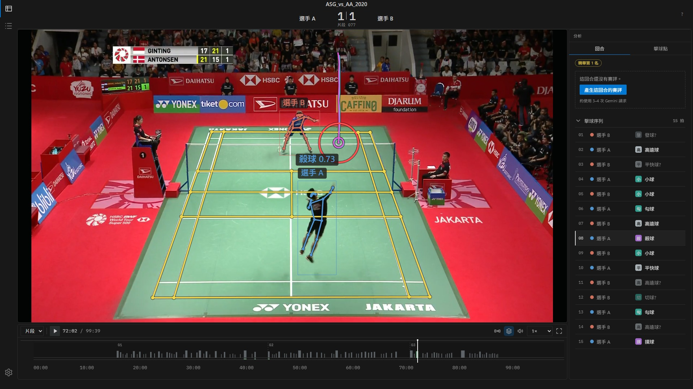
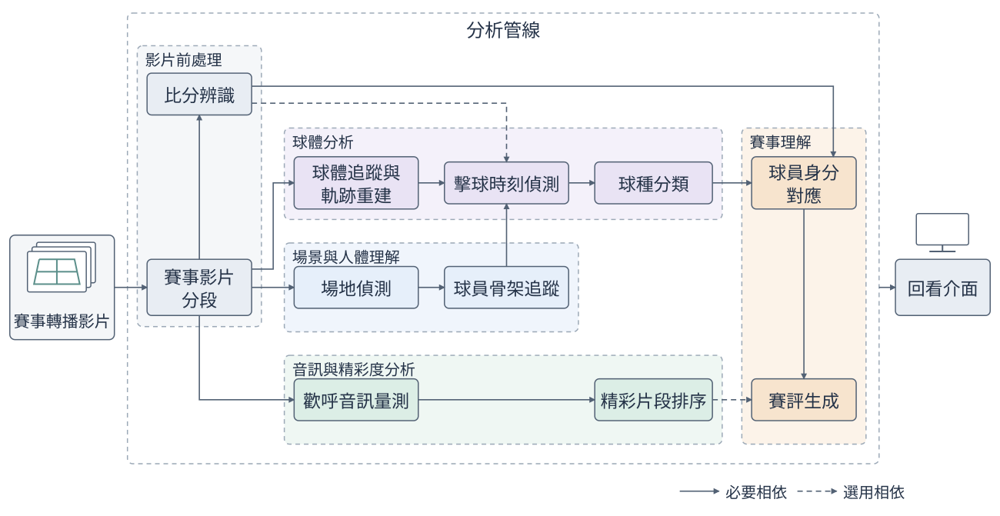

# 羽球比賽分析系統

**Badminton Analysis System**：從羽球單打轉播影片，全自動產出逐拍資料。



輸入一支完整、未經剪輯的羽球單打轉播影片，系統會找出每個比賽片段、讀出比分，逐拍標出擊球時刻、擊球者與球種，並追蹤雙方球員的骨架與羽球軌跡。在這些資料之上，系統還能依觀眾歡呼排出精彩片段，並以大型語言模型撰寫有事實依據的賽評。所有結果都能在回看介面中對照影片檢視。

## 目錄

- [羽球比賽分析系統](#羽球比賽分析系統)
  - [目錄](#目錄)
  - [為什麼做這個](#為什麼做這個)
  - [成果](#成果)
  - [功能](#功能)
    - [分析管線](#分析管線)
    - [延伸階段](#延伸階段)
    - [回看介面](#回看介面)
  - [系統架構](#系統架構)
  - [快速開始](#快速開始)
    - [環境需求](#環境需求)
    - [1. 安裝](#1-安裝)
    - [2. 下載模型權重](#2-下載模型權重)
    - [3. 設定 API key](#3-設定-api-key)
    - [4. 分析一場比賽](#4-分析一場比賽)
    - [5. 開啟回看介面](#5-開啟回看介面)
  - [進階使用](#進階使用)
    - [管線選項](#管線選項)
    - [單獨執行階段](#單獨執行階段)
    - [執行測試](#執行測試)
  - [重現實驗](#重現實驗)
  - [專案結構](#專案結構)
  - [已知限制](#已知限制)
  - [文件](#文件)
  - [致謝](#致謝)

## 為什麼做這個

國際賽事的完整轉播影片大量公開在網路上。教練想歸納對手的慣用球路，研究者想統計戰術或訓練模型，他們需要的都不是影片本身，而是**逐拍資料**：每回合打了幾拍、每一拍是誰打的、打的是什麼球。這些資料目前仍靠人工標記。

學術上已有不少單項方法，例如追蹤羽球的 TrackNetV3、分類球種的 BST，但它們大多假設輸入已經整理好，比賽片段的起訖、球場範圍與擊球時刻都由人工提供。面對一支未經處理的轉播影片，這些前提無從取得。

本專案把這些上游步驟全部自動化，讓既有模型能直接在真實轉播影片上運作，補上從「原始影片」到「逐拍資料」之間的落差。

|              |                                                                                                                 |
| ------------ | --------------------------------------------------------------------------------------------------------------- |
| **輸入**     | 一支完整的羽球單打轉播影片，以 BWF 國際賽事常見的固定俯拍主機位為主                                             |
| **輸出**     | 每個比賽片段的起訖時間與比分、每一拍的擊球影格、擊球者與球種，以及球員骨架、球場範圍與羽球軌跡                  |
| **延伸**     | 精彩片段排序、AI 賽評生成（皆為選用）                                                                           |
| **運作方式** | 賽後批次處理，單機一張消費級 GPU 即可執行。除比分辨識與賽評會呼叫 Gemini API 外，其餘都在本機完成，影片不需上傳 |

## 成果

以 16 支 YouTube 公開的國際賽事單打完整轉播（約 18 小時）建立評估資料，以影片為單位切成 7 場開發集與 9 場測試集。下表數字皆來自**未參與開發的測試比賽**。

| 模組         | 評估資料                        | 主要指標                   | 其他指標                                 |
| ------------ | ------------------------------- | -------------------------- | ---------------------------------------- |
| 賽事影片分段 | 9 場、670 個片段                | **F1 98.66%**（IoU ≥ 0.9） | 邊界誤差中位數 0 影格                    |
| 擊球時刻偵測 | 8 場、6,990 拍                  | **F1 93.14%**（±5 影格）   | Precision 95.49%、Recall 90.90%          |
| 球種分類     | 3 場 BST 未看過的比賽、1,601 拍 | **8 類準確率 87.38%**      | 擊球者準確率 97.88%、Macro-F1 84.71%     |
| 場地偵測     | 9 場、36 個球場外角             | **命中率 72.22%**          | 誤差中位數 2.79 像素，6 場四角全中       |
| 歡呼偵測     | 4 場逐場留一交叉驗證            | **Macro F1 82.70%**        | ROC-AUC 0.96                             |
| 處理時間     | 5 場、片長 332 分鐘             | **回合總長的 2.71 倍**     | 扣除 API 等待後為 1.96 倍（RTX 3060 Ti） |

完整實驗設計與失敗案例分析見[專題報告](docs/latex/report.pdf)第四章。

## 功能

### 分析管線

| 階段                                 | 做什麼                                               | 怎麼做                                                                                                |
| ------------------------------------ | ---------------------------------------------------- | ----------------------------------------------------------------------------------------------------- |
| 賽事影片分段<br>`match_segmentation` | 找出固定主機位的比賽片段，排除重播、特寫與計分板畫面 | 以相鄰影格差異（MAD）為訊號，搭配自適應門檻與跨片段一致性篩選。不需訓練，也不需逐片調參               |
| 比分辨識<br>`score_recognition`      | 讀出每個片段計分板上的比分與局數                     | 多幀合成凸顯計分板，由 Gemini 視覺語言模型逐字轉錄，再由程式挑出當前局比分                            |
| 場地偵測<br>`court_detection`        | 定位球場四個外角，建立畫面與球場平面的對應           | 偵測場線，以單應性吻合度評分選出最佳外角，可在介面中手動校正                                          |
| 球員骨架追蹤<br>`pose`               | 從裁判、線審與觀眾中挑出兩名球員，輸出 17 個關節點   | YOLOX 偵測人體、RTMPose 估計骨架，再把腳點投影到球場平面選人                                          |
| 球體追蹤<br>`shuttle_tracking`       | 逐影格定位羽球、重建軌跡                             | TrackNetV3 產生熱圖，InpaintNet 與 Viterbi 兩種軌跡並存，供下游各取所需                               |
| 擊球時刻偵測<br>`event_detection`    | 找出每一次擊球的影格                                 | 融合羽球軌跡、球員骨架與 BST 逐幀球種機率，經候選生成、篩選、結構性補漏與誤判修剪四步                 |
| 球種分類<br>`stroke_classification`  | 判斷每一拍的球種與擊球者                             | BST（Badminton Stroke-type Transformer），輸出高遠球、發球、小球、平快球、殺球、切球、撲球、勾球 8 類 |

### 延伸階段

| 階段                                | 做什麼                                       | 怎麼做                                                                                                                              |
| ----------------------------------- | -------------------------------------------- | ----------------------------------------------------------------------------------------------------------------------------------- |
| 球員身分對應<br>`player_identity`   | 把畫面上方或下方的球員，對應到計分板上的選手 | 由比分變化推出發球方，再與發球拍的擊球者互相印證，以換邊區間為單位投票                                                              |
| 歡呼音訊量測<br>`audio_highlight`   | 量測每個片段結束前後的觀眾歡呼               | YAMNet 音訊特徵加上輕量分類器，以 3 秒窗口逐段計分                                                                                  |
| 精彩片段排序<br>`highlight_ranking` | 為每個片段打出精彩度分數                     | 歡呼信心與歡呼強度各占一半                                                                                                          |
| 賽評生成<br>`commentary`            | 為回合撰寫逐拍賽評與一句摘要                 | 擊球順序、擊球者與球種由程式從管線結果組成，Gemini 只負責措辭。每句再經模型與規則兩層審查，沒有資料支持的句子改用只陳述事實的模板句 |

### 回看介面

以 Vue 撰寫，可在瀏覽器開發模式使用，也提供 Windows 桌面版（Electron）。

- **影片疊圖**：球場線、球員骨架、羽球與拖尾、擊球閃圈、球種標籤，可逐層開關
- **回合分析欄**：逐拍擊球序列、精彩度排名，並可針對單一回合按需生成賽評
- **多軌時間軸**：回合、比分、歡呼、精彩度與擊球標記，支援全場與單回合兩種縮放
- **分析任務**：直接從介面選擇階段、預覽執行計畫並啟動分析，球場偵測完成後可立即檢查與校正

## 系統架構



管線共 11 個階段，每個階段讀取上游產物、輸出一個 JSON 產物。設計上有四個約定，讓每個階段都能單獨開發、替換與重跑：

1. **統一的資料契約**：各階段只透過 JSON 產物溝通，所有欄位與相依關係集中定義在 [`modules/contracts.py`](modules/contracts.py)。
2. **以完整比賽時間對齊**：視覺結果記錄原始影片的絕對影格編號，音訊記錄整場比賽中的秒數，彼此可直接對照。
3. **依內容判斷是否重跑**：執行器記下每個上游產物的內容雜湊。上游一改，下游自動判為過期並重算，重跑上游得到相同結果則不算變動。
4. **兩相設計與片段快取**：吃 GPU 的階段（球體追蹤、骨架追蹤、擊球時刻偵測）先把模型輸出存進快取，再做純幾何與門檻運算。調參只需重跑第二相，以秒計且不碰 GPU。快取以片段為單位，中斷後可續跑。

## 快速開始

### 環境需求

| 項目           | 需求                                                                                       |
| -------------- | ------------------------------------------------------------------------------------------ |
| 作業系統       | 主要在 Windows 11 開發與測試，Linux 亦可安裝                                               |
| Python         | 3.12，由 [uv](https://docs.astral.sh/uv/) 自動管理                                         |
| FFmpeg         | 需在 `PATH` 中                                                                             |
| GPU            | 建議 NVIDIA RTX 20 系列以上（CUDA 12.8），4 GB VRAM 即可。沒有 GPU 也能跑完，但會慢很多    |
| Node.js        | 22.12 以上，僅回看介面需要                                                                 |
| Gemini API key | 比分辨識與賽評需要，可至 [Google AI Studio](https://aistudio.google.com/app/api-keys) 申請 |

### 1. 安裝

```bash
git clone https://github.com/2026bmtproject/badminton-analysis-system.git
cd badminton-analysis-system
uv sync
```

### 2. 下載模型權重

以下權重請手動下載後放進 `models/`：

| 檔案                                                               | 用途                          | 下載                                                                                                                   |
| ------------------------------------------------------------------ | ----------------------------- | ---------------------------------------------------------------------------------------------------------------------- |
| `TrackNet_best.pt`、`InpaintNet_best.pt`                           | 球體追蹤（TrackNetV3）        | [Google Drive](https://drive.google.com/file/d/1CfzE87a0f6LhBp0kniSl1-89zaLCZ8cA/view?usp=sharing)，下載後解壓縮       |
| `bst_CG_JnB_bone_between_2_hits_with_max_limits_seq_100_merged.pt` | 擊球時刻偵測、球種分類（BST） | [Google Drive](https://drive.google.com/drive/folders/1D4172WZDJWPvpJdpaHDhy_cA-s8F-zR5?usp=sharing)，只需下載這個檔案 |

其餘模型不需手動處理：RTMPose 與 YOLOX 首次執行時由 rtmlib 自動下載，YAMNet 首次執行時從 TensorFlow Hub 下載，歡呼分類器已隨專案附在 `models/yamnet_mean_lr_v1/`。

### 3. 設定 API key

```bash
cp config.yaml.example config.yaml
```

在 `config.yaml` 填入 `gemini_api_key`，或改設環境變數 `GEMINI_API_KEY`（環境變數優先）。`config.yaml` 已被 Git 忽略，不會被提交。

### 4. 分析一場比賽

把轉播影片放進 `matches/<比賽代號>/input/`，再執行整條管線：

```bash
uv run python -m modules.runner matches/<比賽代號>
```

執行器會依相依關係排序各階段，已完成且未過期的階段自動跳過，任一階段失敗即停止。結果寫在同一場比賽的資料夾內：

```text
matches/<比賽代號>/
├── input/      原始影片
├── stages/     各階段的 JSON 產物與執行狀態
└── cache/      可重建的中間結果（降解析度影片、熱圖、骨架偵測等），可隨時刪除
```

> 預設不產生賽評。每個回合約需 3 至 4 次 Gemini 請求，建議在回看介面中針對感興趣的回合按需生成，或參考[進階使用](#進階使用)。

### 5. 開啟回看介面

以 Windows 桌面版為例：

```powershell
cd ui
npm ci
npm run desktop:run
```

> 若 PowerShell 的執行原則擋下 `npm`，改用 `npm.cmd`。

首次開啟時，依序選擇 `matches` 資料夾、已執行過 `uv sync` 的本專案資料夾，以及 `uv.exe` 的位置。之後在 Matches 頁按「匯入比賽」載入已分析完成的比賽，或按「分析比賽」直接從介面啟動分析。

瀏覽器開發模式、打包 unpacked 版本與介面架構，見 [`ui/README.md`](ui/README.md)。

## 進階使用

### 管線選項

```bash
# 忽略已完成的狀態，全部重跑
uv run python -m modules.runner matches/<比賽代號> --force

# 一併執行賽評階段（預設只示範精彩度最高的 3 個回合，可在 config.yaml 調整）
uv run python -m modules.runner matches/<比賽代號> --with-commentary

# 只為指定片段生成賽評（--segment 可重複）
uv run python -m modules.commentary matches/<比賽代號> --segment 7
```

### 單獨執行階段

每個階段都能單獨執行，格式皆為 `uv run python -m modules.<階段名稱> matches/<比賽代號>`。

<details>
<summary>常用範例</summary>

```bash
# 場地偵測：跳出視窗拖曳四個角點微調（Enter 確認、ESC 採用自動結果、R 重設）
uv run python -m modules.court_detection matches/<比賽代號>

# 球體追蹤：只跑 GPU 的熱圖推論，或用既有熱圖改試其他軌跡萃取法
uv run python -m modules.shuttle_tracking matches/<比賽代號> --only-heatmap
uv run python -m modules.shuttle_tracking matches/<比賽代號> --method viterbi --fill kalman

# 骨架追蹤：用既有快取重新選人，並把結果畫在畫面上檢查
uv run python -m modules.pose matches/<比賽代號> --y-margin 0.35 --debug-overlay overlays/

# 擊球時刻偵測：用既有快取重跑偵測，並輸出除錯 CSV
uv run python -m modules.event_detection matches/<比賽代號> --debug-csv hitevents/

# 依分段結果剪出每個片段
uv run python -m modules.common.video_cutter matches/<比賽代號>
```

</details>

各階段的完整參數、快取設計與 GPU 環境細節，見[開發者文件](docs/development.md)。

### 執行測試

```bash
uv run pytest
```

## 重現實驗

報告中的真值、評分程式與逐場結果都公開在 [`experiments/`](experiments/README.md)。下載影片後，先確認與實驗所用的是同一支：

```bash
uv run python experiments/dataset/verify_video.py --all
```

驗證程式依序比對檔案雜湊、影格數與幀率，以及固定影格的畫面指紋，即使影片經過重新壓縮，只要影格序列相同仍可通過。接著跑完管線，再執行各模組的評分程式，例如：

```bash
uv run python experiments/match_segmentation/eval_segments.py
uv run python experiments/event_detection/eval_events.py
```

影片來源與開發集、測試集切分見 [`experiments/dataset/videos.md`](experiments/dataset/videos.md)。

## 專案結構

```text
badminton-analysis-system/
├── modules/               分析管線
│   ├── runner.py          執行器：相依排序、過期判斷、失敗即停
│   ├── contracts.py       各階段的資料契約與相依關係
│   ├── <各階段>/          每個階段一個子套件，皆可單獨執行
│   ├── common/            共用工具與 BST 模型
│   ├── review_export/     把各階段產物整合成回看介面讀取的格式
│   └── local_tasks/       本機分析任務服務，供介面啟動分析
├── ui/                    回看介面（Vue、Electron）
├── experiments/           真值、評分程式與實驗結果
├── tests/                 單元測試
├── docs/                  專題報告、設計文件與圖表
├── models/                模型權重
└── matches/               每場比賽的影片與分析結果（不進版本控制）
```

## 已知限制

- **依賴轉播形式**：規則建立在 BWF 轉播的慣例上，例如固定俯拍主機位，且只處理單打。手持或多機快切的影片無法分段，資料集 16 支影片中有 15 支來自 BWF，跨轉播單位的泛化能力尚未驗證。
- **無法察覺自身錯誤**：場地偵測遇到底線旁的廣告字樣容易失準，且失敗時仍正常輸出。系統目前沒有信心度判斷，只能靠使用者回看時發現並在介面中校正。
- **球種資料的瓶頸**：把擊球時刻換成真值後，球種準確率只提升 1.16 個百分點，主要誤差來自 BST 本身。擊球時刻的漏偵測則使端到端準確率再低約 8 個百分點。
- **外部 API**：比分辨識與賽評依賴 Gemini API，比分辨識約占總處理時間的 28%。
- **非即時**：處理時間約為回合總長的 2.7 倍，目前只適合賽後分析。

## 文件

| 文件                                    | 內容                                       |
| --------------------------------------- | ------------------------------------------ |
| [專題報告](docs/latex/report.pdf)       | 完整的動機、方法、實驗與討論               |
| [開發者文件](docs/development.md)       | 各階段的參數、快取與目錄結構、GPU 環境細節 |
| [回看介面](ui/README.md)                | 介面架構、桌面版與開發模式、本機任務 API   |
| [實驗](experiments/README.md)           | 真值來源、評分方式與各模組結果             |
| [賽評契約](docs/commentary-contract.md) | 賽評產物的欄位與相容性                     |

## 致謝

本專案建立在以下研究與開源專案之上：

- **TrackNetV3**：Chen and Wang, *TrackNetV3: Enhancing ShuttleCock Tracking with Augmentations and Trajectory Rectification*, MMAsia 2023. [[論文]](https://doi.org/10.1145/3595916.3626370)
- **BST**：Chang, *BST: Badminton Stroke-type Transformer for Skeleton-based Action Recognition in Racket Sports*, 2025. [[arXiv]](https://arxiv.org/abs/2502.21085)
- **ShuttleSet**：Wang et al., *ShuttleSet: A Human-Annotated Stroke-Level Singles Dataset for Badminton Tactical Analysis*, KDD 2023。擊球時刻與球種的評估真值取自此資料集。[[arXiv]](https://arxiv.org/abs/2306.04948)
- **RTMPose**：透過 [rtmlib](https://github.com/Tau-J/rtmlib) 執行人體偵測與姿態估計。[[arXiv]](https://arxiv.org/abs/2303.07399)
- **YAMNet**：Google 以 AudioSet 訓練的音訊分類模型。[[GitHub]](https://github.com/tensorflow/models/tree/master/research/audioset/yamnet)
