- [一、簡介](#一簡介)
  - [研究動機](#研究動機)
  - [專題目標](#專題目標)
  - [系統概觀](#系統概觀)
  - [主要貢獻與系統亮點](#主要貢獻與系統亮點)
  - [主要結果](#主要結果)
  - [報告結構](#報告結構)
- [二、文獻探討](#二文獻探討)
  - [現有羽球分析系統與產品](#現有羽球分析系統與產品)
  - [關鍵子任務的既有方法](#關鍵子任務的既有方法)
    - [回合切割](#回合切割)
    - [球場偵測](#球場偵測)
    - [球體追蹤](#球體追蹤)
    - [擊球偵測](#擊球偵測)
    - [球種辨識](#球種辨識)
    - [計分板讀分](#計分板讀分)
  - [研究缺口與本系統定位](#研究缺口與本系統定位)
- [三、系統設計](#三系統設計)
  - [系統架構](#系統架構)
  - [影片前處理](#影片前處理)
    - [賽事影片分段](#賽事影片分段)
      - [概述](#概述)
      - [影格差異訊號](#影格差異訊號)
      - [自適應門檻](#自適應門檻)
      - [跨片段一致性篩選](#跨片段一致性篩選)
      - [邊界精修](#邊界精修)
    - [計分板辨識](#計分板辨識)
      - [概述](#概述-1)
      - [多幀合成前處理](#多幀合成前處理)
      - [VLM 轉錄讀分](#vlm-轉錄讀分)
      - [還原被合併的回合](#還原被合併的回合)
  - [場景與人體理解](#場景與人體理解)
    - [場地偵測](#場地偵測)
      - [概述](#概述-2)
      - [球員遮擋前處理](#球員遮擋前處理)
      - [球場區域定位](#球場區域定位)
      - [場線偵測](#場線偵測)
      - [單應性與吻合度評分](#單應性與吻合度評分)
      - [外角候選](#外角候選)
      - [角點重估與邊界修正](#角點重估與邊界修正)
      - [結果驗證與評分](#結果驗證與評分)
    - [球員骨架追蹤](#球員骨架追蹤)
      - [概述](#概述-3)
      - [感知：人體偵測與姿態估計](#感知人體偵測與姿態估計)
      - [選人：腳點與球網分半](#選人腳點與球網分半)
  - [球體分析](#球體分析)
    - [球體追蹤與軌跡重建](#球體追蹤與軌跡重建)
      - [概述](#概述-4)
      - [熱圖偵測與快取](#熱圖偵測與快取)
      - [軌跡修補（InpaintNet）](#軌跡修補inpaintnet)
      - [多候選軌跡修補（Viterbi）](#多候選軌跡修補viterbi)
      - [雙軌跡並存](#雙軌跡並存)
    - [擊球時刻偵測](#擊球時刻偵測)
      - [概述](#概述-5)
      - [逐幀球種證據](#逐幀球種證據)
      - [候選生成](#候選生成)
      - [候選篩選](#候選篩選)
      - [結構性補漏](#結構性補漏)
      - [誤判修剪](#誤判修剪)
    - [球種分類](#球種分類)
      - [概述](#概述-6)
      - [分類流程](#分類流程)
  - [音訊與精彩度分析](#音訊與精彩度分析)
    - [歡呼音訊量測](#歡呼音訊量測)
      - [概述](#概述-7)
      - [音訊切窗](#音訊切窗)
      - [歡呼分類](#歡呼分類)
      - [歡呼強度估計](#歡呼強度估計)
      - [片段層級聚合](#片段層級聚合)
    - [精彩片段排序](#精彩片段排序)
      - [概述](#概述-8)
  - [使用者介面](#使用者介面)
    - [概述](#概述-9)
    - [回看工作區](#回看工作區)
      - [播放器與疊圖](#播放器與疊圖)
      - [回合分析欄](#回合分析欄)
      - [時間軸](#時間軸)
    - [分析任務與場地校正](#分析任務與場地校正)
    - [實作概要](#實作概要)
- [四、實驗結果](#四實驗結果)
  - [資料集與重現方式](#資料集與重現方式)
  - [各模組結果](#各模組結果)
    - [賽事影片分段](#賽事影片分段-1)
      - [偵測準確率](#偵測準確率)
      - [邊界精度](#邊界精度)
      - [失敗案例與限制](#失敗案例與限制)
    - [場地偵測](#場地偵測-1)
      - [定位誤差](#定位誤差)
      - [命中率](#命中率)
      - [失敗案例與限制](#失敗案例與限制-1)
    - [擊球時刻偵測](#擊球時刻偵測-1)
      - [偵測準確率](#偵測準確率-1)
      - [時間誤差](#時間誤差)
      - [失敗案例與限制](#失敗案例與限制-2)
    - [球種分類](#球種分類-1)
      - [分類準確率](#分類準確率)
      - [上游影響](#上游影響)
      - [失敗案例與限制](#失敗案例與限制-3)
    - [歡呼偵測與精彩度分析](#歡呼偵測與精彩度分析)
      - [歡呼偵測資料集與評估方式](#歡呼偵測資料集與評估方式)
      - [跨比賽歡呼偵測結果](#跨比賽歡呼偵測結果)
      - [歡呼強度方法選擇](#歡呼強度方法選擇)
      - [Segment 聚合方法選擇](#segment-聚合方法選擇)
  - [端到端結果](#端到端結果)
    - [處理時間](#處理時間)
    - [時間分布](#時間分布)
    - [限制](#限制)
    - [應用於延遲直播的可能性](#應用於延遲直播的可能性)
- [五、討論](#五討論)
  - [系統優點與限制](#系統優點與限制)
    - [音訊支線的限制](#音訊支線的限制)
  - [整個專題哪裡用了AI，怎麼用](#整個專題哪裡用了ai怎麼用)
- [附錄](#附錄)
  - [音訊實驗來源與待補資料](#音訊實驗來源與待補資料)
- [參考文獻](#參考文獻)

# 一、簡介

## 研究動機

羽球國際賽事的完整轉播影片大量公開於網路，BWF 即在 YouTube 上釋出歷年賽事的全場影片。然而對分析而言，這些影片仍只是原料：一場比賽打了多少回合、每回合有幾拍、每拍是什麼球種、在場上哪個位置擊出、比分如何推進，目前仍須由人逐拍觀看並標記。ShuttleSet [9] 等羽球資料集即以人工逐拍標記建立，自動定位擊球幀的研究 [5] 也以減少這類人工作業為出發點。

在嘗試將既有方法套用於完整轉播影片時，我們發現學術上的單項方法大多預設輸入已經整理好：球種分類需要已知的擊球時刻與球員骨架，擊球時刻偵測需要羽球軌跡，而軌跡與骨架分析又必須先知道哪些畫面屬於回合、球場位於畫面何處。這些前提在資料集中由人工標記提供，面對一支未經處理的轉播影片時卻無從取得。要讓任何一項分析在真實影片上運作，就必須將它所依賴的上游步驟一併自動化。

因此，本專題希望補上從「原始轉播影片」到「逐拍結構化資料」之間的落差：建立一套離線、全自動的分析管線，輸入一場完整的單打轉播，輸出回合切分、比分、球場位置、球員骨架、羽球軌跡、擊球時刻與球種等逐拍資訊，並以此為基礎產生賽評與精彩片段。

## 專題目標

本專題的目標是讓上述管線在真實轉播影片上從頭到尾自動跑完，且每一項逐拍輸出都能以未參與開發的比賽量化驗證。系統的適用範圍如下：

- **輸入**：一支完整、未經剪輯的羽球單打轉播影片，比賽畫面以固定俯拍的主機位為主，即 BWF 國際賽事的常見轉播形式。
- **運作方式**：離線批次處理，單機一張消費級 GPU 即可執行；除計分板讀分與賽評需呼叫外部 API 外，其餘皆在本機完成。
- **非目標**：雙打、即時轉播分析，以及取代 Hawk-Eye 等需專用攝影設備的電子判決系統。

## 系統概觀

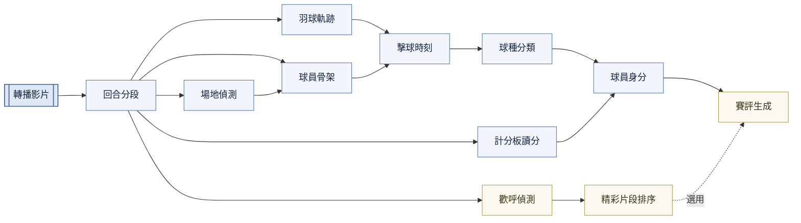

系統共十一個階段，可分為四層。**前處理**先從整部影片中切出固定機位的回合片段，並讀取每個片段的比分，界定後續所有分析的範圍；**場景理解**在片段內定位球場、追蹤兩名球員的骨架與羽球軌跡；**擊球分析**結合軌跡與骨架找出每一次擊球的影格，再判斷球種與擊球者；**延伸應用**（圖中淺黃色）則以前述結構化結果與賽事音訊為基礎，產生精彩片段排序與賽評。每個階段只輸出一份格式統一的 JSON 檔，各模組的設計與實作見第三章。

## 主要貢獻與系統亮點

1. **把既有方法所依賴的上游前提一併自動化。** 回合範圍、比分與球場位置在資料集中原由人工提供，本系統分別以影格差異訊號分段、視覺語言模型（VLM）直接讀取計分板，以及幾何式球場外角定位取得，不需針對每支影片人工標記或調整參數。TrackNetV3 [1]、BST [2] 等既有模型因此能直接在未經處理的轉播影片上運作。
2. **模組化、可局部重跑的管線。** 各模組仍在持續改進，因此每個階段都能單獨替換與重跑：階段之間只透過統一的資料契約溝通，執行器以上游產物的內容雜湊判斷結果是否過期，中間結果以片段為單位快取。調整其中一個模組時，只需重算真正受影響的部分。
3. **公開、可重現的評估。** 實驗使用 16 支 YouTube 公開的單打完整轉播，以影片為單位切分為開發集與測試集。我們公開每支影片的雜湊與影格指紋，讓他人能確認自己下載的影片與我們標記時所用的一致；真值、評分程式與逐場結果也一併公開。
4. **以結構化結果為依據的精彩片段與賽評。** 音訊支線以 YAMNet [10] 特徵辨識觀眾歡呼，依歡呼程度為片段排序，作為畫面之外的另一種精彩度訊號。賽評由生成式 AI 根據逐拍的擊球、球種、比分與球員身分撰寫，並經另一道審查逐拍比對分析結果，駁回沒有資料支持的描述，例如憑空推測的落點、因果或比分。

## 主要結果

下表為各模組在未參與開發之比賽上的頭條指標，完整實驗與失敗案例分析見第四章。

| 模組         | 評估範圍                          | 主要結果                                             |
| ------------ | --------------------------------- | ---------------------------------------------------- |
| 回合分段     | 9 場、670 個片段                  | F1 98.66%，邊界誤差中位數 0 影格                     |
| 場地偵測     | 9 場、36 個球場外角               | 角點誤差中位數 2.79 像素，6 場四角全部命中           |
| 擊球時刻偵測 | 8 場、6,990 拍                    | Precision 95.49%、Recall 90.90%（±5 影格）           |
| 球種分類     | 3 場 BST 未曾見過的比賽、1,601 拍 | 8 類準確率 87.38%；含擊球漏偵測的端到端準確率 78.99% |
| 歡呼偵測     | 4 場、逐場交叉驗證                | Macro F1 0.83                                        |
| 處理時間     | 5 場、共 97.8 分鐘回合            | 約為回合總長的 2.7 倍（RTX 3060 Ti）                 |

整體而言，回合分段與擊球時刻偵測已接近可直接使用的程度，下游的球種分類則受上游累積誤差影響，端到端準確率比單看分類低約 8 個百分點。主要限制在於：資料集 16 支影片中有 15 支來自 BWF 官方轉播，對其他轉播單位的泛化能力尚未驗證；歡呼偵測僅以 4 場比賽評估；處理時間未計入音訊、身分對應與賽評等延伸階段。

## 報告結構

本報告共分為五章。第一章介紹本專題的研究動機、目標、系統概觀與主要結果；第二章回顧羽球賽事分析的相關研究與現有方法，並說明本專題與過去研究的差異；第三章介紹系統的整體架構，以及各個分析模組的設計與實作方式；第四章透過實驗評估各模組的分析結果與整體系統的表現；第五章討論本專題的優點與限制，並說明人工智慧技術在系統中的應用。

# 二、文獻探討

本章回顧羽球影片分析的既有工作：先看整合式系統與商用產品的整體做法與不足，再依本系統面對的關鍵子任務整理學術界的既有方法，最後收斂出研究缺口與本系統的定位。各項技術本身的原理與實作細節不在此贅述，留待第三章各模組說明。

## 現有羽球分析系統與產品

近年來，隨著電腦視覺與運動分析技術的發展，現有的羽球賽事分析技術已涵蓋了即時判決、羽球軌跡追蹤以及影片內容分析等應用。現有的系統依其應用情境，大致可分為正式賽事使用的商用系統，以及以自動化影片分析為核心的學術研究端整合系統。

商用系統以 Hawk-Eye 為代表，該系統主要是透過多視角攝影設備追蹤羽球軌跡與落點，提供專業賽事中的即時判決輔助，此類系統著重即時性與判決精度，高度依賴專用攝影、運算設備以及專業團隊的部署與維護，因而提高成本與使用門檻。

學術研究則逐漸由單一任務發展為多模組整合。 Guo et al.提出的 AI-Powered Badminton Coach [6] 將球場偵測、羽球追蹤、球員姿態、擊球事件、球種分類與判斷回合勝負等任務串接為完整分析流程，最後輸出結構化的賽事資訊，證明多項羽球影片分析任務可以整合於同一套自動化分析流程中。

然而，現有方案仍存在不同限制。商用系統主要針對專業賽事環境設計，較難直接套用於一般既有的賽事影片。學術研究雖已證實多項影片分析任務能被整合，但多著重個別辨識方法及最終分析結果，對於多階段流程中的模組相依、統一資料介面與局部重跑機制較少著墨。

## 關鍵子任務的既有方法

本節依子任務整理既有方法的路線與限制。引用中的「§」與「表」指向原文的章節與表格，未編號的章節以原文標題標示。

### 回合切割

既有方法多利用「回合進行時，轉播固定以俯拍主機位拍攝」的慣例，把回合切割化約為逐幀判斷是否為比賽畫面。一類是監督式分類：Ghosh 等人以 HOG 特徵搭配 SVM 分類，再以 Kalman 濾波平滑 [14, §4.1]；Chien 與 Yu 以 CNN 分類拍攝角度，單幀準確率達 99.76%，換算成回合後 F1 卻只有 89.27%，作者歸因於轉播鏡頭形式多變 [5, §Rally-wise Video Trimming、表 2–4]。另一類是與參考畫面比對：Bosi 計算每幀與使用者選定之參考畫面的 RGB 差與 PSNR，以經驗門檻判斷 [8, §4.2]。也有整合系統直接使用資料集中已切好的回合片段 [6, §III-A]。前者需要逐幀標記，後者需要人工選定參考畫面與門檻。

### 球場偵測

學習式方法以標記資料訓練場地關鍵點偵測器，例如以 Court R-CNN 輸出單打場地的 6 個關鍵點 [5, §Court Keypoints Detection]，或以 YOLO 架構偵測 14 個場地地標 [7, §III]。幾何式方法利用場線結構與已知尺寸，不需訓練：AI-Powered Badminton Coach 以 Hough 直線取得候選線，再做透視校正 [6, §III-B]；MonoTrack 把標準球場模型對到候選線上，並指出原演算法寫死的角度門檻使約四分之一的影片失敗，改良後成功率由 73.9% 提升至 85.5% [13, §4.1]。Bosi 的系統則由使用者人工點出球場四角 [8, §4.4]。學習式需要標記資料，幾何式常倚賴預設的顏色或角度門檻，人工指定則需逐支影片操作。

### 球體追蹤

羽球小、快且常被遮擋，既有方法分為熱圖式與偵測框式兩條路線。熱圖式以 TrackNet 家族為代表，輸入連續數幀、輸出標示球位置的熱圖 [12]；TrackNetV2 被多個整合系統直接採用 [6, §III-B; 8, §4.5]，TrackNetV3 再加入背景估計與 inpainting 軌跡修補 [1, 摘要]。偵測框式如 Singha 等人修改 YOLOv8，移除大物件偵測頭以強化小物件偵測 [7, §III]。此外，多數系統另以 ARIMA、內插等後處理修正軌跡 [6, §III-B; 8, §4.6.1]。

### 擊球偵測

既有方法依所用訊號可分為四種思路：

1. **軌跡幾何。** 在球的 Y 座標找峰值、X 座標找極值 [8, §4.6.2]，開源專案 SoloShuttlePose [4] 亦屬此類。殺球前後球的運動方向連貫，此法容易漏抓 [8, §5.3.5]。
2. **球員姿態。** 以 Transformer 由雙方骨架序列預測羽球飛行方向，方向轉換處即為擊球幀 [5, §Hit-Frame Detection]；容差由 ±15 收緊到 ±5 幀時，F1 由 79.55% 降至 63.92% [5, 表 6]。
3. **多源學習式。** MonoTrack 的 HitNet 以 GRU 讀取球場角點、姿態與羽球位置，逐幀判斷是否擊球，再以動態規劃施加「最短間隔、擊球者交替」約束，F1 由 0.866 提升至 0.946 [13, §4.4、表 1]；AI-Powered Badminton Coach 先判斷擊球者並以其切換處分段，再依羽球角度變化定位擊球幀 [6, §III-C]。
4. **音訊。** 以 LPC 殘差偵測擊球聲 [8, §4.7]，但球評、觀眾等背景噪音使召回率不理想 [8, §5.3.5]。

單一訊號各有盲點；多源方法表現較佳，但 HitNet 需以標記資料訓練，且依賴球場、姿態與羽球等上游輸入 [13, §4.4]。

### 球種辨識

既有方法的差異主要在輸入型態：AI-Powered Badminton Coach 以 131 維手工特徵搭配邏輯迴歸 [6, §III-D]；Singha 等人以 SlowFast 與 TimeSformer 直接處理原始影像 [7, §III]；BST 則以球員骨架、羽球軌跡與場上位置為輸入 [2, §3.2]。BST 須先知道擊球時刻才能切出每一拍的片段 [2, §3.1]，並依賴姿態估計、羽球追蹤與場線偵測三個既有模型的輸出 [2, 摘要]。

### 計分板讀分

羽球文獻中鮮少直接辨識計分板：Ghosh 等人的比分由人工標記 [14, §3]，AI-Powered Badminton Coach 只判斷回合勝方、不讀比分 [6, §III-D]，Bosi 雖把比分列為目標，最終並未實現 [8, §4.1、§5.3.6]。網球的 SmartTennisTV 自動定位計分板後以 OCR 辨識，再以計分規則修正錯誤，但指出 Tesseract 需依賽事人工設定前處理 [15, §3.2–§3.4]。

## 研究缺口與本系統定位

綜合前兩節，既有工作仍有三項缺口。第一，回合範圍、球場位置、比分等上游前提多由人工或資料集提供，連 HitNet、BST 等較強的模型也假設這些輸入已經就緒。第二，以學習式方法自動化這些上游步驟時，又需要逐幀或場地標記，換賽事、換場館就可能要重做。第三，既有整合系統多著重個別辨識結果，對模組相依、統一資料介面與局部重跑較少著墨。

本系統定位為一條離線、批次執行的分析管線：把上游前提一併自動化，讓既有的成熟模型能直接用在未經處理的轉播影片上；各階段只透過統一的資料契約溝通，可單獨替換與重跑（見[系統架構](#系統架構)），並在此基礎上產生精彩片段排序與自然語言賽評。各子任務的路線如下表。

| 子任務     | 本系統的路線                                             | 詳見                                      |
| ---------- | -------------------------------------------------------- | ----------------------------------------- |
| 回合切割   | 影格差異訊號，門檻由影片自身分布估計；免標記、免參考畫面 | [賽事影片分段](#賽事影片分段)             |
| 計分板讀分 | VLM 直接轉錄計分板，免逐賽事前處理                       | [計分板辨識](#計分板辨識)                 |
| 球場偵測   | 幾何式，不預設球場顏色，由內部場線反推外角               | [場地偵測](#場地偵測)                     |
| 球體追蹤   | 預訓練 TrackNetV3，加上多候選 Viterbi 後處理             | [球體追蹤與軌跡重建](#球體追蹤與軌跡重建) |
| 擊球偵測   | 融合軌跡、骨架與球種模型，以結構約束補漏拍               | [擊球時刻偵測](#擊球時刻偵測)             |
| 球種分類   | 預訓練 BST，輸入全由前述模組自動產生                     | [球種分類](#球種分類)                     |
| 歡呼偵測   | YAMNet 特徵辨識觀眾歡呼，作為精彩度訊號                  | [歡呼音訊量測](#歡呼音訊量測)             |

# 三、系統設計
## 系統架構

本系統是一條離線批次處理的管線。輸入是一支未經剪輯的賽事轉播影片，輸出是逐拍的結構化資料：每個回合的時間範圍與比分、球場座標基準、球員骨架、羽球軌跡，以及每一次擊球的影格與球種。目前 registry 註冊十一個階段，包含原有七個視覺階段、音訊歡呼量測、精彩片段排序、球員身分對應與賽評生成；執行器依使用者選取範圍與相依關係規劃順序。音訊支線由分段結果界定範圍，其結果不影響視覺模型的競賽事實；賽評生成需使用者明確選取。

**系統架構圖：**

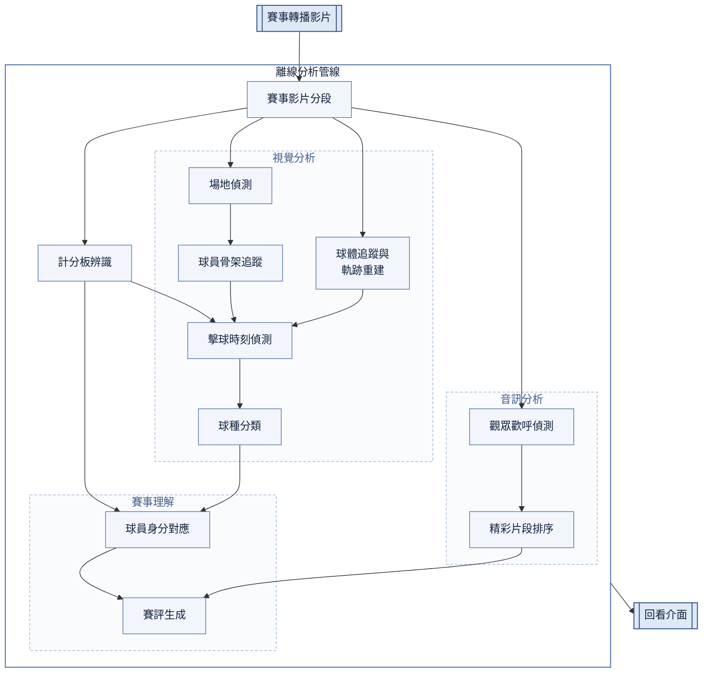

**draw.io 樣圖參照：系統架構**

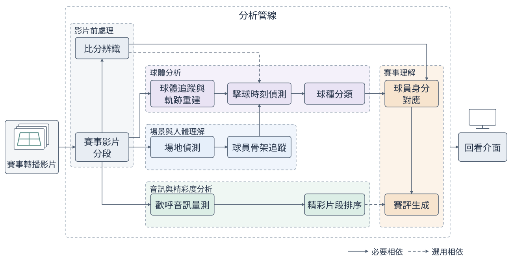

[編輯原始檔](figures/report/system-architecture.drawio) · [向量 PDF](figures/report/system-architecture.pdf)

圖中箭頭只畫階段之間的直接先後關係，隱含在箭頭鏈中的相依不重複畫出（例如球種分類也讀取骨架與羽球軌跡）。完整相依見下表。

**資料流總圖：**

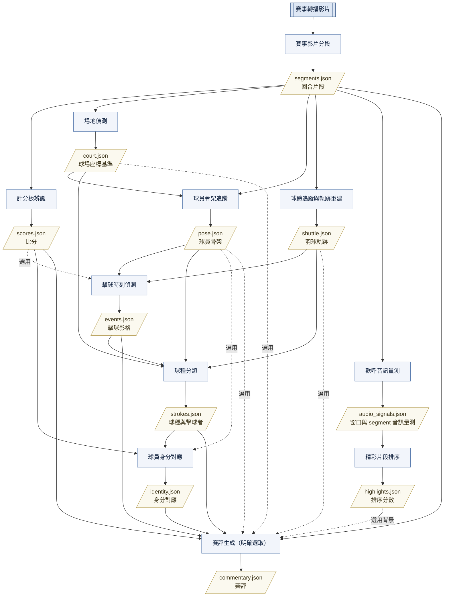

除分段階段外，其餘階段都以 `segments.json` 界定分析範圍：視覺階段從原始影片讀取影格，音訊階段讀取對應波形，身分對應與賽評則整合結構化產物，因此不需要事先把影片剪成一個個小檔案。

**模組相依與輸入輸出：**

| 階段               | 相依階段                                   | 輸出檔               | 一筆記錄的內容                                                             |
| ------------------ | ------------------------------------------ | -------------------- | -------------------------------------------------------------------------- |
| 賽事影片分段       | —（直接讀原始影片）                        | `segments.json`      | 一個固定機位比賽片段的起訖影格與起訖秒數                                   |
| 計分板辨識         | 分段                                       | `scores.json`        | 一個片段的記分板觀察、發球方與局數；片段內有多筆觀察時另記子比分與切點秒數 |
| 場地偵測           | 分段                                       | `court.json`         | 球場四個外角，以及球場公尺與影像像素之間的單應矩陣                         |
| 球體追蹤與軌跡重建 | 分段                                       | `shuttle.json`       | 一幀中羽球的座標與可見性，兩種軌跡各一份                                   |
| 球員骨架追蹤       | 分段、場地偵測                             | `pose.json`          | 一幀中兩名球員的 17 個關節點與人體框                                       |
| 擊球時刻偵測       | 球體追蹤、骨架追蹤（比分為選用）           | `events.json`        | 一次擊球的影格編號                                                         |
| 球種分類           | 擊球偵測、骨架追蹤、球體追蹤、場地偵測     | `strokes.json`       | 一次擊球的球種（8 類）、擊球者與信心                                       |
| 音訊歡呼量測       | 分段                                       | `audio_signals.json` | segment 聚合訊號，以及供時間曲線使用的窗口分類分數                         |
| 精彩片段排序       | 音訊歡呼量測                               | `highlights.json`    | 每個 segment 的啟發式排序分數                                              |
| 球員身分對應       | 球種分類、計分板（骨架為選用）             | `identity.json`      | 跨片段球員身分 epoch 與來源                                                |
| 賽評生成           | 分段、擊球偵測、球種分類、計分板、身分對應 | `commentary.json`    | 片段與逐拍賽評；精彩度、骨架、場地及羽球軌跡為選用                         |

比分對擊球偵測是「有就用、沒有也能跑」的選用相依：它只支撐一條精修規則，不應讓使用者為了偵測擊球而必須先準備 API 金鑰。

**設計約定：** 管線由三個約定串起來，讓各階段能各自開發、單獨執行與重跑。

1. **單一產物、統一格式。** 每個階段只寫一個 JSON 產物，外層固定是一個物件、內含一組記錄陣列，記錄欄位由程式中的資料類別統一定義。因為形狀一致，讀寫共用同一組函式，新增階段只需定義資料類別，不必自己寫檔案 I/O；下游也只依賴這份契約，不必匯入上游的實作。
2. **以完整比賽時間對齊。** 視覺事件使用原始影片的絕對影格編號，音訊窗口保留完整比賽的絕對起訖秒數。跨模態資料藉原始幀率與 segment 索引對齊；聚合訊號依 `segments.json` 對應其片段範圍。
3. **產物與快取分離。** 每場比賽一個資料夾，分成三區：`input/` 放原始影片，`stages/` 放各階段產物與紀錄執行狀態的 `status.json`，`cache/` 放昂貴但可重建的中間結果（降解析度影片、TrackNet 熱圖、人體偵測結果、逐幀球種機率）。快取以內容命名並以片段為單位存放，因此中斷可續跑，重新分段時也只有內容真正改變的片段需要重算。

**執行與重跑：** 執行器依相依關係排序後逐一執行各階段，已完成的階段預設跳過。跳過與否不只看「是否跑過」，還會比對上游產物的內容雜湊：上游重跑後結果改變的階段會被標記為過期並重做。任一階段失敗即停止整條管線，後續階段不會拿到半成品。

## 影片前處理
### 賽事影片分段

#### 概述

**問題與目標：** 一支羽球轉播影片中，適合進行球員、羽球軌跡分析的畫面，主要來自固定俯拍的機位。若系統直接分析整部影片，非固定機位比賽畫面會產生大量錯誤資料，也浪費運算資源。本模組從轉播影片中找出固定機位比賽畫面，作為後續模組的輸入。

**設計重點：** 本模組不需額外訓練模型、標註資料，也不需針對每支影片逐片人工調整參數，依據影片的統計結構自適應於不同影片。核心設計是把「固定機位比賽畫面主要只有球員移動」這個先驗，轉化為影格差異訊號。固定機位比賽片段的相鄰影格差異小、運鏡與鏡頭切換差異大、靜止的計分板差異極小，因此只用一個廉價的差異指標（MAD）就能把固定機位比賽片段與其他畫面在數值上分開。另一個核心設計是利用「同一機位在不同片段間具有高度相似性」，排除計分板、重播及其他靜止畫面。在 9 場未參與開發的比賽上，片段偵測 F1 達 98.66%（見[實驗結果](#偵測準確率)）。

**處理流程總覽：**

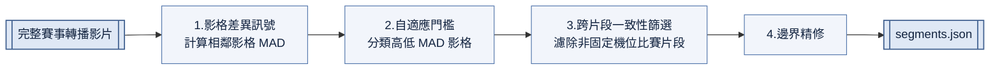

**draw.io 樣圖參照：賽事影片分段**

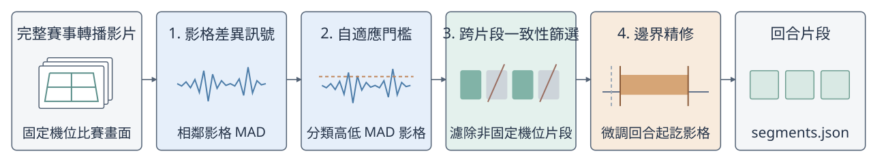

[編輯原始檔](figures/report/match-segmentation.drawio) · [向量 PDF](figures/report/match-segmentation.pdf)

#### 影格差異訊號

固定機位比賽片段畫面中只有兩名球員與球在動，兩影格間的差異小。其餘片段則落在兩個極端，鏡頭移動與切換使差異極大，靜止的計分板與定格畫面則差異極小。本模組以影格與影格之間的差異作為核心訊號。差異以 MAD（平均絕對差，Mean Absolute Difference）衡量：

$$\mathrm{MAD} = \frac{1}{MN}\sum_{x=1}^{M}\sum_{y=1}^{N} \left| I_1(x,y) - I_2(x,y) \right|$$

其中 $M$、$N$ 為影像寬高，$I(x,y)$ 為座標 $(x,y)$ 的灰階值。選用 MAD 的理由是成本低廉、對離群值不敏感、且動態範圍足夠。計算前先將影片縮放至 480p 以減少計算量。MAD 不隨解析度改變，相對高低仍然成立。

取樣採每隔三個影格一次，並與前一個取樣影格計算 MAD。間隔取樣一方面縮短處理時間，一方面避免特寫片段和固定機位比賽片段混淆。特寫中球員動作緩慢、背景固定，MAD 偏低且接近固定機位比賽片段，間隔取樣把緩慢位移放大、拉高其 MAD。固定機位比賽片段中球員佔比小、動作劇烈，間隔取樣影響有限。兩類片段因此在 MAD 上分開。

<figure>
  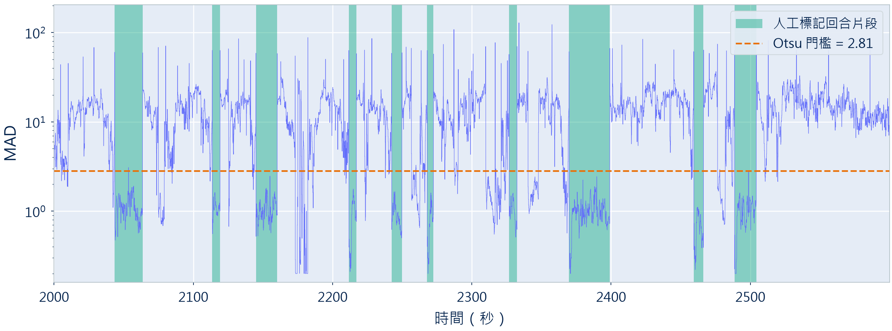
  <figcaption>部分片段 MAD </figcaption> 
</figure>

圖 3-1 中綠色區塊為手動標記的固定機位比賽片段，虛線為系統算出的門檻，可見綠色區塊的 MAD 通常低於門檻。

#### 自適應門檻

本階段統計全片的 MAD 分佈，設定一個門檻把影格分成低 MAD（固定機位比賽畫面、靜止畫面）與高 MAD（運鏡、鏡頭切換）。不同影片的分佈不同，門檻須隨影片自動調整。

分析前先對 MAD 取以 10 為底的對數。鏡頭切換到完全不同畫面時每個像素都不一樣，會產生極大 MAD，使分佈右側出現長尾。取對數可壓縮長尾，使高低兩側尺度相當。實作取 $\log_{10}(\max(\mathrm{MAD}, 1))$，因為 MAD 可能為 0，需要地板值 1。

<figure>
  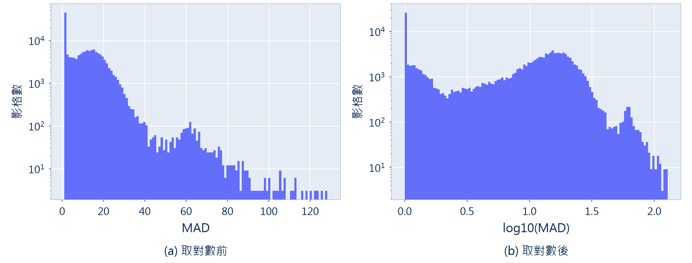
  <figcaption>取對數</figcaption> 
</figure>

**乾淨片段偵測：** 若輸入本身無鏡頭切換，重尾程度會遠低於多鏡頭影片，據此判定乾淨固定機位片段，跳過後續步驟直接輸出。

**門檻方法：** 設門檻的問題與影像二值化相似，二值化統計像素亮度並切成兩類，本階段統計影格 MAD 並切成兩類，故沿用二值化的門檻計算方法。本系統採 Otsu 法，它只要求兩類均值不同即可分離，不限制分佈形狀、不需調參，正好適用於本階段低 MAD 側有尖峰、高 MAD 側是不對稱長尾的情形。

<figure>
  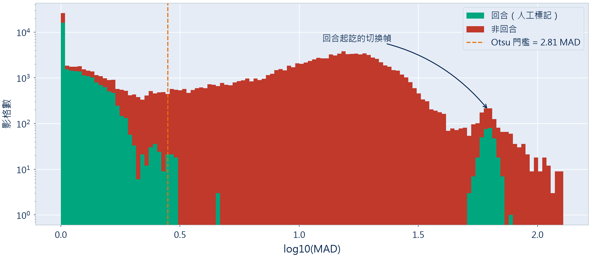
  <figcaption>固定機位比賽片段與其他片段的 MAD 分佈</figcaption> 
</figure>

<figure>
<table border="1" style="margin: 0 auto;">
  <thead>
    <tr>
      <th>MAD 區間</th>
      <th>佔全片比例</th>
      <th>固定機位比賽比例</th>
      <th style="text-align:center;">畫面性質</th>
    </tr>
  </thead>
  <tbody>
    <tr>
      <td>0–0.5</td>
      <td>6.8%</td>
      <td>28%</td>
      <td>近乎靜止</td>
    </tr>
    <tr>
      <td>0.5–2</td>
      <td>23%</td>
      <td>75%</td>
      <td>固定機位比賽畫面</td>
    </tr>
    <tr>
      <td>2–2.75</td>
      <td>2.3%</td>
      <td>5%</td>
      <td>谷底，門檻落點</td>
    </tr>
    <tr>
      <td>2.75–30</td>
      <td>65%</td>
      <td>約 0%</td>
      <td>重播、運鏡</td>
    </tr>
    <tr>
      <td>30 以上</td>
      <td>2.8%</td>
      <td>7%</td>
      <td>快速轉場</td>
    </tr>
  </tbody>
</table>
  <figcaption>log10(MAD) 的分佈與組成</figcaption>
</figure>

**三類切分：** 直接做兩類 Otsu 會產生系統性偏差，高 MAD 側佔全片 68% 且橫跨 2.75 至 128，類內變異遠大於低 MAD 側，會把切點從谷底推進高 MAD 團內部，讓大量非固定機位比賽影格進入下一步。改用三類切分，上切點（10.80）吸收長尾壓力，下切點（2.81）回到谷底，取下切點為門檻。三類 Otsu 的效果等價於先移除長尾再做兩類 Otsu。

<figure>
  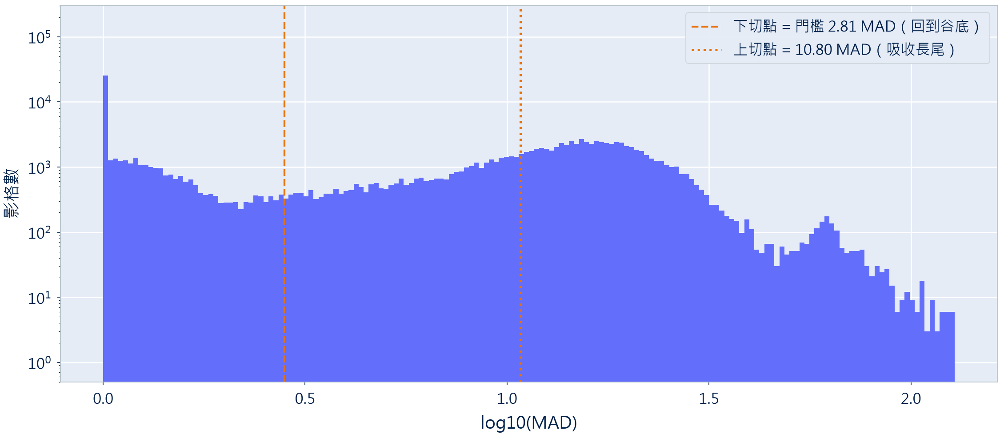
  <figcaption>三類 Otsu 的兩個切點</figcaption>
</figure>

#### 跨片段一致性篩選

將連續低 MAD 影格串接成片段，此時保留下來的片段中仍混有計分板、定格等靜止片段。關鍵觀察是，此時剩餘的固定機位比賽片段數量多，且全部來自同一個固定機位、彼此在畫面上高度相似。其他片段則各自不同，與任何片段都不像。因此可以透過片段之間相互比較，判斷一個片段是否屬於佔多數的固定機位比賽片段。

設共有 $N$ 個片段，片段 $i$ 取其中央兩張影格，各自縮放至 $128\times72$ 並展開為特徵向量 $v_i^{(1)}, v_i^{(2)}$。兩片段的差異 $d(i,j)$ 取四組跨影格 MAD 的平均，跨片段平均差異 $\bar{d}(i)$ 則是片段 $i$ 對其餘 $N-1$ 段的平均：

$$
d(i,j) = \frac{1}{4}\sum_{a=1}^{2}\sum_{b=1}^{2} \mathrm{MAD}\!\left(v_i^{(a)},\, v_j^{(b)}\right),
\qquad
\bar{d}(i) = \frac{1}{N-1} \sum_{j \neq i} d(i,\, j)
$$

<figure>
  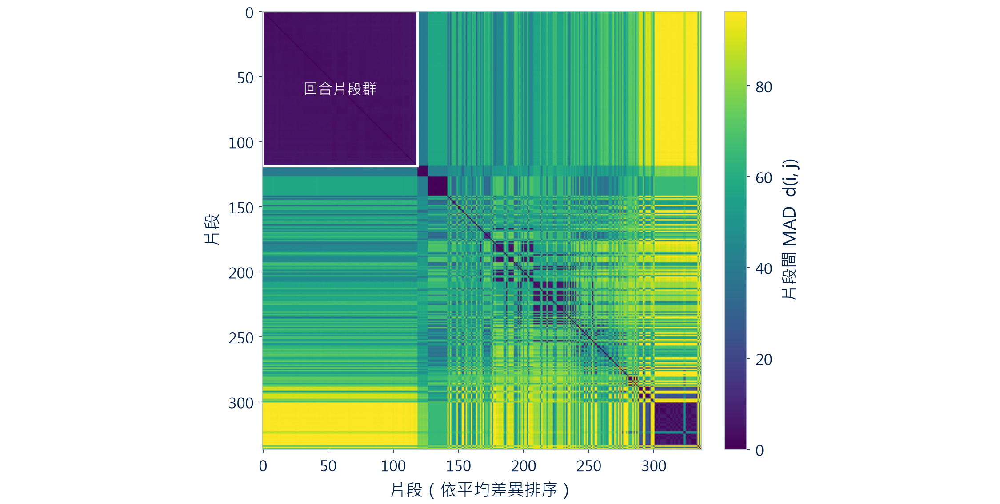
  <figcaption>跨片段兩兩 MAD 矩陣（依平均差異排序）</figcaption> 
</figure>

因為所有固定機位比賽片段高度相似，它的 $\bar{d}(i)$ 幾乎只由少數幾個非固定機位比賽片段貢獻，數值因而偏低。又因固定機位比賽片段彼此相像，算出的 $\bar{d}(i)$ 也幾乎相等，於是它們在直方圖最左側聚成一個緊密的群。其他片段畫面各異， $\bar{d}(i)$ 偏高且分散。圖 3-5 將片段依 $\bar{d}(i)$ 排序，左上角的紫色密集區即這群固定機位比賽片段。

實測固定機位比賽片段間 $\bar{d}(i)$ 的極差在 5% 以內，最小的非固定機位比賽片段比全體最小值大 13%，門檻取全體最小值的 1.07 倍。此門檻成立的前提是固定機位比賽片段屬於最緊密的群，若影片含大量彼此相似的畫面，會形成新的低 $\bar{d}(i)$ 群使門檻失效，對此的替代方案（KNN 局部密度）見〈設計取捨〉。

<figure>
  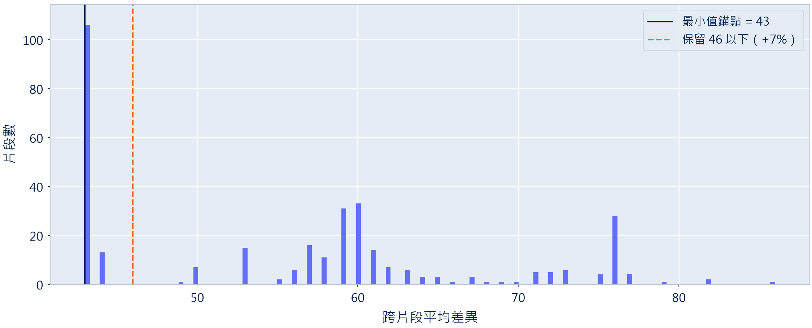
  <figcaption>跨片段平均差異的分佈與門檻</figcaption> 
</figure>

通過篩選的片段中偶爾仍殘留鷹眼判定、官方重播等電腦合成畫面，其構圖與固定機位比賽畫面接近。因此對剩餘片段再算一次跨片段平均差異，採較嚴格的門檻，捨棄超過中位數三倍者。

#### 邊界精修

此階段把被少數高 MAD 影格（分數卡片動畫）切碎的片段接回。同時第一階段的跳幀取樣使邊界存在系統性偏差，需還原到影格層級。

**做兩次片段連接：** 第一次只看距離，間距小於 5 張影格的相鄰片段直接接合。第二次針對 12 張影格以內的間隙逐影格重新掃描，僅當間隙內最大相鄰 MAD 低於 25（即不存在尖峰）時才接合。

**做邊界對齊：** 在每個邊界附近逐影格計算相鄰 MAD，尋找同時滿足絕對值門檻與區域中位數倍率的尖峰，此尖峰對應剪接點，起點設為切入尖峰所在的影格，終點設為切出尖峰的前一張影格。

<figure>
  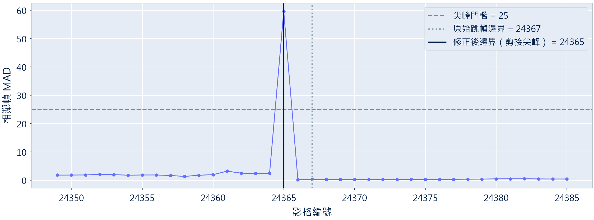
  <figcaption>邊界尖峰偵測與修正</figcaption>
</figure>

圖 3-7 中灰色點線為原始跳幀取樣邊界，深藍實線為修正後的邊界，橘色虛線為尖峰門檻。


### 計分板辨識
 
#### 概述
 
**問題與目標：** 賽事影片分段模組切出的片段中，同一回合可能因中間插入重播、特寫而被切成數段，一個片段也可能因為沒有鏡頭切換而包含多個回合。本模組為每個片段讀出畫面上的記分板比分，判斷片段所屬的回合，該比分同時供下游精彩片段分析使用。
 
**設計重點：** 讀記分板天生受三個困難制約：泛化性（各賽事的記分板設計、位置不固定，且須避開干擾文字）、可讀性（記分板小又模糊）、多局制（三局制記分板易讀錯局）。本模組不需訓練模型或逐賽事調參，以「把難題拆成模型擅長的小任務、再用程式補上模型不擅長的部分」為核心，有三點做法：
 
1. **使用視覺語言模型（VLM）：** 目前使用傳統 OCR 的開源專案都需要手動標記計分板的位置。VLM 直接理解畫面結構，依視覺上下文自行分辨比分。不用為每種記分板寫過濾規則或手動標記，提升跨賽事的泛化能力。
2. **多幀合成：** 利用逐像素合成，強化記分板、糊化背景和球員。在 overlay 只出現於三成影格時仍能完整還原。
3. **提示詞設計：** 轉錄取代挑選，令模型由左到右完整抄寫計分板上所有數字（模型擅長），把當前局比分的挑選（模型易錯）移到程式端，讓較便宜的模型也能快速、正確的完成任務。
 
**處理流程總覽：**
 
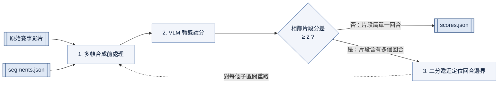

#### 多幀合成前處理
 
本步驟為每個片段產生一張合成圖，讓 VLM 讀一張圖就拿到比分。轉播的記分板 overlay 只在片段的部分影格出現，若逐張送 VLM 去找，每個片段都得呼叫多次。一個片段通常同屬一回合，比分不變、記分板靜態，因此把片段取樣的多張影格逐像素合成，間歇出現的記分板被疊加強化、穩定呈現在合成圖上，一個片段只需一次 API 呼叫。不斷移動的球員與觀眾被平均糊化，順帶為 VLM 濾去干擾。
 
合成採 dominant_cluster（主群集平均）：對每個像素的亮度值分箱，只平均落入最多值的那一箱。overlay 出現時亮度幾乎固定，會全擠進同一箱。背景每幀不同而分散各箱。因此最密集的一簇即為記分板。這個方法不預設目標信號在時間上佔多數，即使轉播 overlay 只間歇出現仍能保留。
 
<figure>
  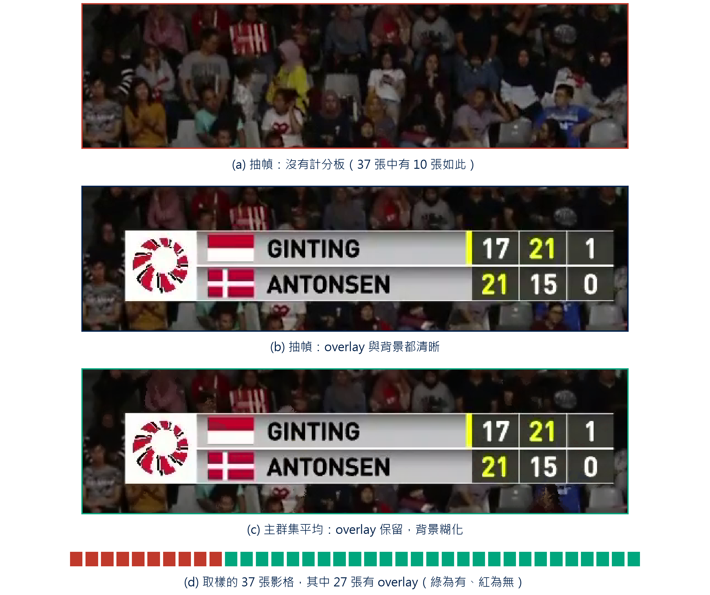
  <figcaption>overlay 只出現在部分影格時，主群集平均的還原結果</figcaption>
</figure>

#### VLM 轉錄讀分
 
本步驟從合成圖讀出雙方當前比分。多局制記分板每隊並列多局數字，要模型直接判斷「哪個是當前局」容易錯，完整抄寫數字對模型來說不需要推理，比較簡單。因此只要求模型逐隊由左到右抄下所有數字，挑選交給程式，固定取每隊陣列最右一個為當前比分，從根源消除模型讀錯局的可能。
 
實作上使用 Gemini 2.5 Flash，將 temperature 設為 0，並且關閉 thinking，減少結果變化的同時避免模型進行不必要的推理，多餘的推理浪費 token 、時間又容易出錯。

<figure>
  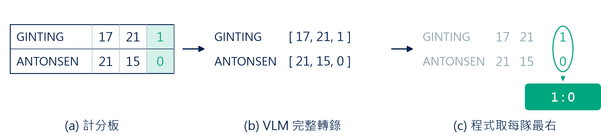
  <figcaption>轉錄取代挑選，VLM 完整抄寫每隊數字，程式取最右一個為當前比分</figcaption>
</figure>
 
#### 還原被合併的回合
 
分段以鏡頭切換為訊號，兩回合間若沒有切換就會被併進同一片段，此時記分板在片段中途變動，單張合成只讀得到其中一個回合。本步驟負責找出並拆開這類片段。

判斷靠比分本身，正常一回合雙方總分只加一分，因此若某片段雙方比分總和一次增加兩分以上，就代表中間有回合沒被單獨切出，標記為合併片段。

標記後以二分搜尋定出回合交界，在候選區間中點重新合成、讀分，與兩端比較，往比分仍有跳變的一側收斂，逼近比分改變的影格。由於一個片段可能併入不只兩回合，每定出一個切點就對兩側子區間各自遞迴、繼續二分，直到每個子區間都只差一回合。

## 場景與人體理解
### 場地偵測

#### 概述

**問題與目標：** 後續所有球員與球體分析需要以球場座標來解讀位置與距離。本模組從固定俯拍的轉播畫面中定出球場，建立影像平面與球場平面投影的座標基準，供後續步驟使用。

**設計重點：** 本模組不需訓練模型、不需標註，核心是把球場偵測化約為「在畫面中找四個外角」的問題，球場是平面、尺寸由競賽規則規定，定出四角即可解出單應性，其餘 12 條線與 16 個交點全由它投影得出。本模組的初始版本參考了一份以 OpenCV 實作的開源羽球場地偵測程式 [3]，現行版本在其基礎上重新設計，將顏色寫死的處理改為顏色無關的表面分割，並以消失點過濾與網格枚舉取代原本 O(n⁴) 的四邊線窮舉。在此基礎上有三點做法：

1. **零先驗的顏色自適應：** 球場顏色因場館而異，系統不預設任何色彩範圍，參考色與門檻全從畫面即時估計。相較多數開源方案需固定顏色範圍或手動標記，本法無需逐場調參。
2. **多來源並聯、統一吻合度評分裁決：** 不押注單一路徑，兩種遮罩、三種外角來源並行推導，最後由同一個「場線像素吻合度」的評分選出最佳者。遮罩斷裂這類錯誤不可逆，並聯確保唯一的路不會走死。
3. **以最可靠的內部線反推最不可靠的外角：** 球場外緣線透視壓縮最重、最常被遮斷，最難完整偵測。網格枚舉改由遮擋少的內部發球線與中線一起投票決定四角，把證據取用的方向倒轉過來。

在 9 場未參與開發的比賽上，角點定位誤差中位數為 2.79 像素（見[實驗結果](#場地偵測-1)）。

**處理流程總覽：**

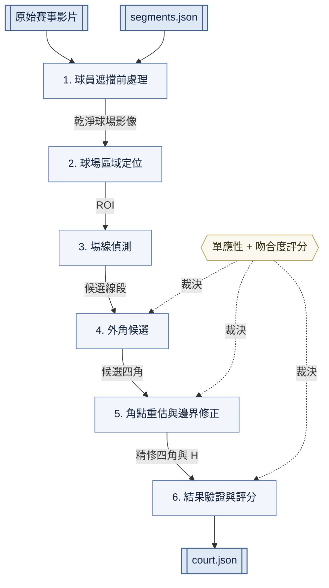

#### 球員遮擋前處理

後續定位球場的主要訊號是顏色與場線，但轉播畫面中球員持續移動遮住場線與色塊，單張影格會使線條斷裂。本步驟要產生一張不含球員與短時雜訊的乾淨球場影像。機位固定時，球場在每張影格的同一座標都呈現相同顏色，唯有球員經過的少數影格例外，故對每個座標取多影格像素值的中位數，佔多數的球場顏色留下、屬於少數的球員與雜訊被濾除。

$$M(x,y) = \mathrm{median}\{I_1(x,y),\dots,I_K(x,y)\}$$

<figure>
  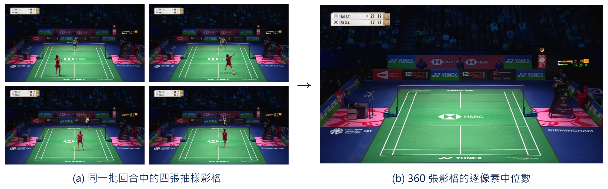
  <figcaption>四張取樣影格與合成圖</figcaption>
</figure>

#### 球場區域定位

本步驟要圈出球場在畫面中的範圍，好把範圍外的線段擋在後續場線偵測之外。實測對整張畫面掃描會得到近 200 條線段，真正屬於球場的只有 12 條。

<figure>
  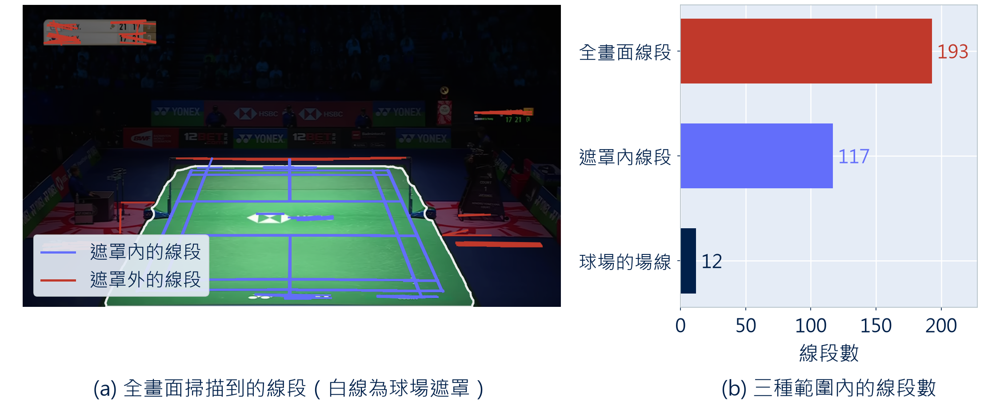
  <figcaption>全畫面掃描到的線段，與落在球場遮罩內的部分</figcaption>
</figure>

分離球場與周邊地板的明顯特徵是顏色，但球場顏色本身未知。做法是在畫面中央偏下取一塊由機位假設保證落在場內的區域 $S$，取其像素在 Lab 色度（a、b）通道的中位數作為球場參考色 $\mathbf{c}$，任一像素的色度與 $\mathbf{c}$ 的距離小於門檻 $\tau_c$ 即判為球場：

$$\mathbf{c} = \big(\mathrm{median}_{S}\,a,\ \mathrm{median}_{S}\,b\big), \qquad \tau_c = \max\!\Big(18,\ 3 \cdot \tfrac{\sigma_a + \sigma_b}{2}\Big)$$

$$C(x,y) = \big[\,\lVert\,(a(x,y),\,b(x,y)) - \mathbf{c}\,\rVert < \tau_c\,\big]$$

其中 $\sigma_a,\sigma_b$ 為 $S$ 在兩色度通道的標準差。捨棄亮度通道使光照與陰影不進入判斷。用中位數以避免取樣區塊內的現像素影響門檻。門檻取 $3\sigma$ 使其隨取樣塊自身的顏色離散程度放寬，下限 18 則用以容忍過於平滑的場地。

<figure>
  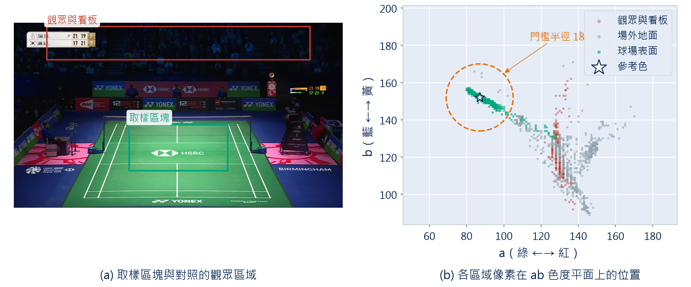
  <figcaption>取樣區塊、參考色與門檻的判定</figcaption>
</figure>

上述門檻得到的是逐像素獨立的判斷，還不是一塊完整區域。白色場線把場地切成數塊，雜訊與反光留下零星破洞。模組以形態學運算補洞去雜點、取面積最大的連通區域、再自畫面左上角向內填充背景，把內部空洞併回球場。

<figure>
  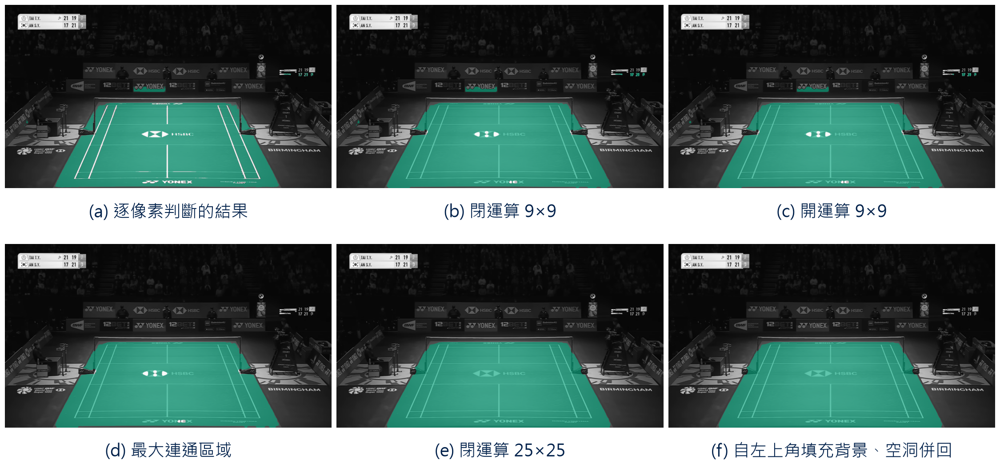
  <figcaption>形態學清理、最大連通區域與空洞填補各階段的遮罩變化</figcaption>
</figure>

本步驟實際產生的不只一張遮罩。除上述色度版本外，另備一個紋理版本，在色度條件之外再加一道局部亮度標準差門檻，只留下平滑區域，用以濾掉與場地同色卻花紋雜亂的地面贊助商圖樣。另有一個低色度版本，在整體畫面色度過低、色度判準失效時改以亮度相似度取代色度。這些版本不互相取代，而是一併往下送，構成後續多假設並行的二至三組遮罩。

<figure>
  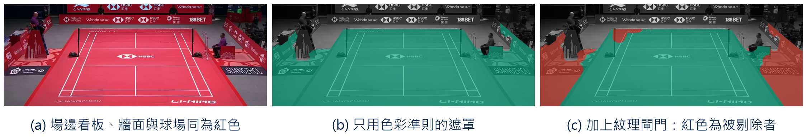
  <figcaption>場邊看板與球場同色時，紋理版本剔除色度版本誤納的區域</figcaption>
</figure>

#### 場線偵測

本步驟要在前一步的遮罩範圍內找出球場線，過程分四段，取出屬於線的像素、把像素組織成線段、濾除不屬於球場的線段、合併接近的線段。

取線像素不靠色彩，轉播素材的曝光與白平衡各異、場線的絕對色值並不固定。使用局部亮度突起，一個像素若比水平（或垂直）方向兩側都亮出門檻 $\tau$，即屬近垂直（或近水平）的線像素，$P_h$、$P_v$ 取聯集，比較距離 $d$ 須大於線寬。

$$P_h(x,y) = \big[\,G(x,y)-G(x-d,y) > \tau\,\big] \wedge \big[\,G(x,y)-G(x+d,y) > \tau\,\big]$$

$$P_v(x,y) = \big[\,G(x,y)-G(x,y-d) > \tau\,\big] \wedge \big[\,G(x,y)-G(x,y+d) > \tau\,\big]$$

<figure>
  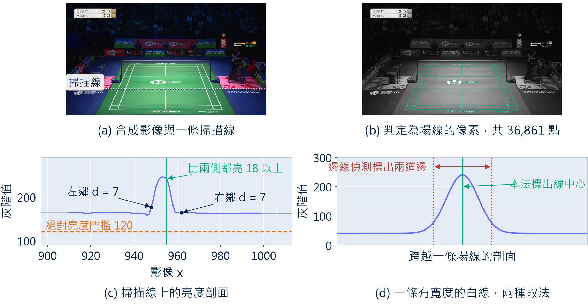
  <figcaption>局部亮度突起與場線像素的萃取結果</figcaption>
</figure>

上一步的輸出是散落的像素，以機率霍夫轉換（PPHT，`cv2.HoughLinesP`）把共線者組織成線段。場線常因球員殘影、地面反光與遮罩侵蝕而斷開，霍夫轉換靠投票決定共線性、不依賴像素連通，能跨越這些缺口。

<figure>
  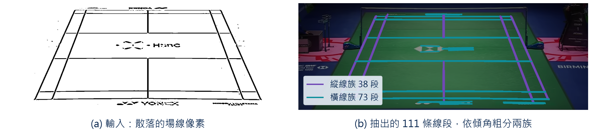
  <figcaption>霍夫線段與兩族的角度粗分</figcaption>
</figure>

粗分後仍混有地面贊助商圖樣等非球場線段，以透視幾何篩選。球場的 12 條線分屬兩組平行線，在畫面上各自通過一個消失點。找消失點是離群比例可能很高的穩健估計問題，採 RANSAC，隨機取兩條線段、以交點為候選消失點，統計族內有多少線段方向指向它（以線段長度加權），重複數百次取支持度最高者。

<figure>
  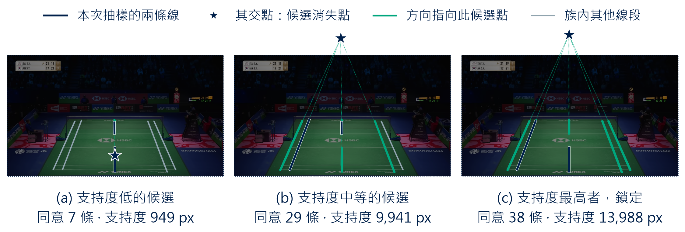
  <figcaption>消失點 RANSAC 三次抽樣的候選點與其支持度</figcaption>
</figure>

球網遮擋常把一條球場線拆成方向略有出入的數段，同一條物理線會以不同位置重複參與運算，故先合併。同族線段方向相近、只在垂直於該方向的位置上分開，取一條參考線把每條線段化為一維位置，位置相近者歸為一簇，每簇以最小平方擬合出一條代表線。數百條線段因此收斂成十餘條物理線，既去除重複，也把後續窮舉的組合數壓到可行範圍。

<figure>
  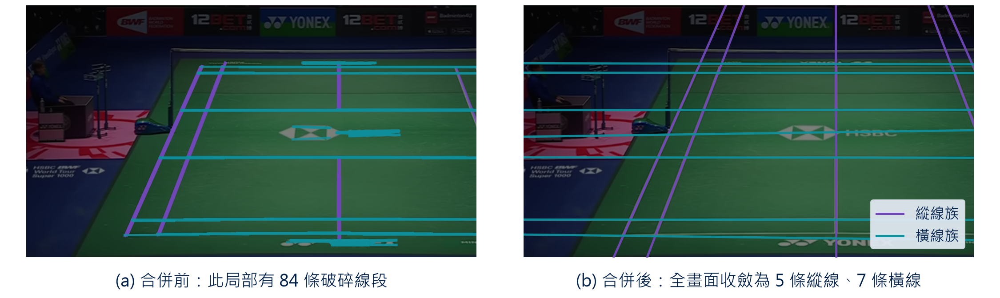
  <figcaption>同族線段合併的前後對比</figcaption>
</figure>

#### 單應性與吻合度評分

本步驟解決「如何由四角解出單應性、如何量化一組四角的好壞」的問題。

羽球場的尺寸與 12 條場線位置皆為已知常數，因此可預先建立球場模型座標：5 條縱線對應固定的 x 值，7 條橫線對應固定的 y 值。將模型四角與影像中偵測到的四角建立對應後，即可用 DLT 解出單應性 $\mathrm{H}$，再由 $\mathrm{H}$ 將模型中的 12 條場線與 16 個交點一併投影至影像。

DLT 對趨近退化的輸入不會報錯，仍會得出病態的 $\mathrm{H}$，故對每個 $\mathrm{H}$ 加設合法性檢查：四角須為有限值、不超出畫面、不退化成細條、近端底線不短於遠端。此檢查貫穿後續所有產生 $\mathrm{H}$ 的階段。

<figure>
  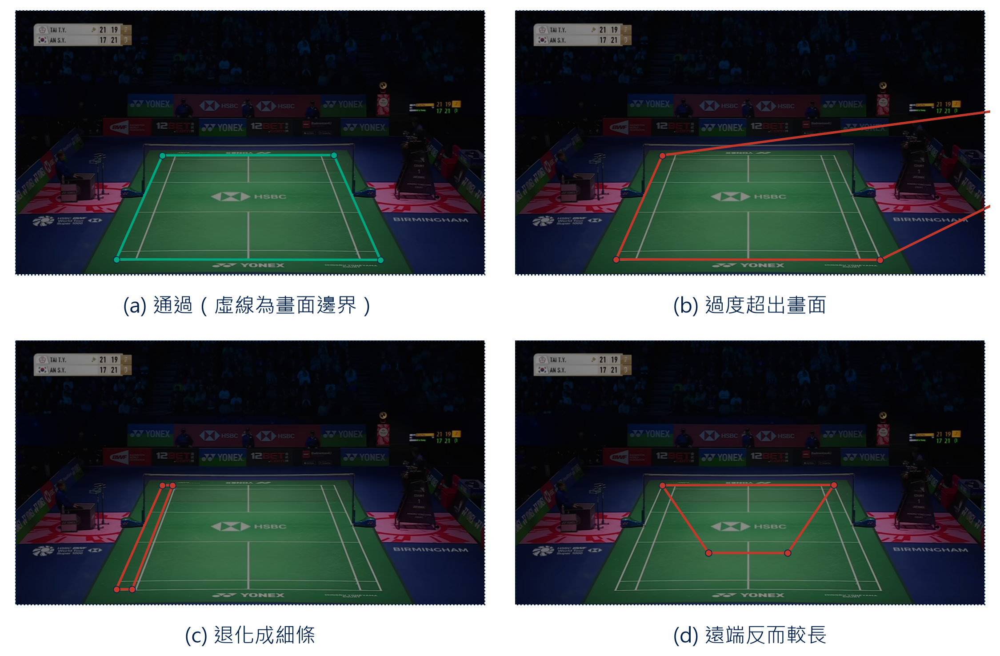
  <figcaption>合法性檢查</figcaption>
</figure>

吻合度評分衡量一 $\mathrm{H}$ 推出的網格與畫面上實際偵測到的場線像素有多吻合。單條線的覆蓋率定義為：沿線等距取若干點、投影到影像，落在最近場線像素容差（4 像素）內的比例。總評分取「貼合度」與「廣度」兩項相乘：

$$S = \underbrace{\frac{1}{12}\sum_{k=1}^{12}\mathrm{cov}_k}_{\text{貼合度}} \times \underbrace{\frac{1}{12}\big\lvert\{\,k : \mathrm{cov}_k > 0.3\,\}\big\rvert}_{\text{廣度}}$$

此評分是整個場地偵測判斷好壞的統一依據，後續的候選選擇與邊界修正都以它裁決。

<figure>
  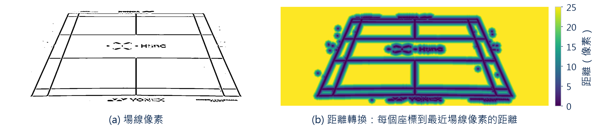
  <figcaption>場線像素與其距離轉換圖</figcaption>
</figure>

#### 外角候選

四角須由偵測到的線或遮罩推導，任一種推導都有其失效條件，故本模組並行三種來源、各給一組候選，三者的失效條件互不重疊。

**網格枚舉（主要方法）：** 從候選縱線任取兩條作左右邊界、橫線任取兩條作上下邊界，四線相交得一組四角，枚舉所有 $\binom{10}{2}\times\binom{12}{2}=2970$ 組合，取 12 線網格吻合度最高者。穩健的關鍵在於以最可靠的內部線反推最不可靠的外角，等於讓發球線與中線一起投票決定四角。

<figure>
  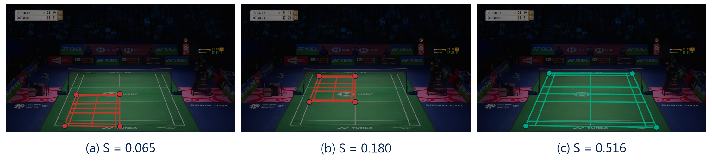
  <figcaption>網格枚舉的候選與其吻合度評分</figcaption>
</figure>

**極端線相交：** 在兩族中各取最外側的兩條線相交得四角，最直接，但要求那四條極端線全部正確，而外緣線最難偵測，故僅作第二來源。它的失效條件與網格枚舉不同，能在枚舉搜尋空間無正解時補位。

**遮罩凸包：** 改用遮罩形狀，取面積最大的外輪廓、求凸包並簡化為多邊形，再由頂點座標的極值取出四角。它不需任何場線，但遮罩邊界經形態學處理與空洞填補、未必等於球場外緣，精度最低，僅在前兩者都產生不出合法 $\mathrm{H}$ 時作為備援。

#### 角點重估與邊界修正

前一步的四角只由少數代表線相交而得，影像中大量場線像素尚未參與，本步驟用上全部線像素把結果調準，分兩階段。

**以 ICP 重估單應性：** 難點在建立線像素與球場模型的對應，影像中場線因透視而方向各異，難以直接配對。利用前一步的近似 $\mathrm{H}$，把每個線像素反投影回球場座標，那裡的縱線是 $x$ 為定值、橫線是 $y$ 為定值的直線，量出該像素離哪條最近即建立對應。再用全部點對重解 $\mathrm{H}$、以新 $\mathrm{H}$ 更新對應，反覆逼近。點對數以千計，採 RANSAC 版本把配錯到相鄰線的像素當離群值排除，對應的距離門檻隨迭代由寬到窄。

<figure>
  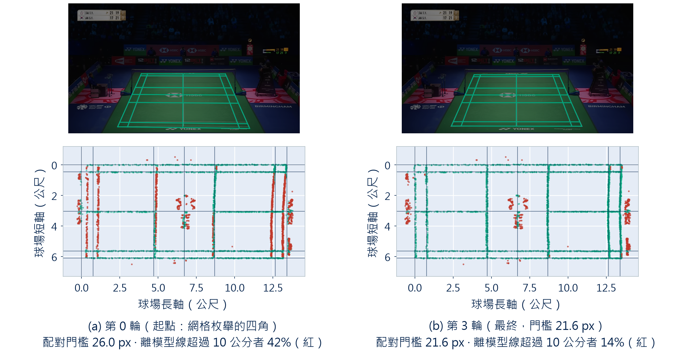
  <figcaption>ICP 第一輪與最終輪的網格與反投影殘差</figcaption>
</figure>

**邊界修正：** 透視壓縮下球場遠端的內、外邊界在畫面上靠得很近，全域解無從分辨，外邊界可能整條鎖到內側線上。本步驟只動四條外邊界，把某條投影線附近的像素依「離線多遠」投到一維直方圖，每條平行線形成一個峰，二維的找線因此降為一維的找顯著峰。遠端刻意偏取最外側的峰重新擬合邊界，因為兩種誤差不對稱，外邊界略往場外時場內物體的相對位置仍成立、下游影響有限，一旦鎖進內側則截斷場內內容、不可逆。搜尋帶寬由寬到窄逐級縮小。這是帶方向的推測，故結果不直接採用，而是回到吻合度評分重算，只有分數未明顯變差才取代原解。

<figure>
  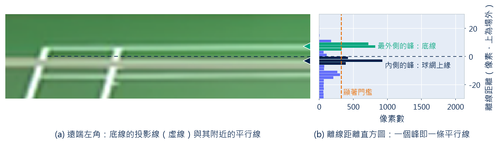
  <figcaption>投影線的鄰近像素與其離線距離直方圖</figcaption>
</figure>

<figure>
  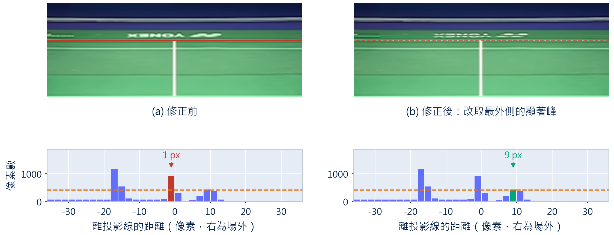
  <figcaption>遠端底線由內側峰改取最外側峰的前後對比</figcaption>
</figure>

#### 結果驗證與評分

前述步驟以多假設並行：球場區域定位產生二至三組遮罩，場線偵測再對每組遮罩各給三種外角候選，故候選池大小為遮罩組數乘以三，每個候選都帶著它所依據的線像素圖。本步驟把這一池候選收斂成唯一答案，每個候選經角點重估與邊界修正後，在自己的線像素圖上算出吻合度評分，全部比較之下取最高者，其四角與單應性即為模組的最終輸出。

<figure>
  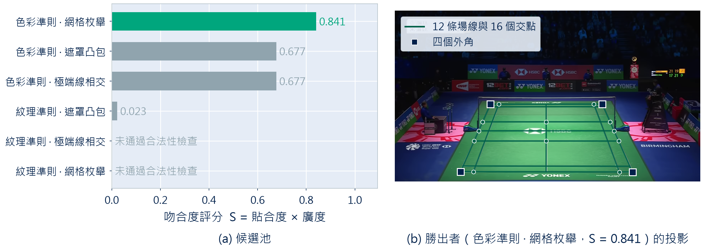
  <figcaption>候選池的吻合度評分與勝出者的投影</figcaption>
</figure>


### 球員骨架追蹤

#### 概述

**問題與目標：** 球種分類需要球員的肢體姿態，本模組為每個片段還原場上兩名球員逐幀的骨架，作為下游球種分類的輸入。難點有二：一是廣角轉播下球員在畫面裡常只有一兩百像素高，手肘、手腕等末端關節不易估準；二是畫面中除兩名球員外還有裁判、線審、球僮與觀眾，每個人都有骨架可抽，必須靠球場幾何從中認出真正的球員。

**設計重點：** 本模組的核心不在姿態模型本身，而在如何從畫面中的眾多人體骨架穩定選出真正上場的兩名球員。利用球場幾何與跨幀行為自適應完成，主要有兩點做法：

1. **球場座標選人：** 系統把每個候選人的腳點反投影到正規化球場座標，依所在半場判定遠、近端身分，再綜合場內位置與透視校正後的身高挑選球員。

2. **長短期時序資訊：** 系統先從整場候選人的落點分布找出長時間不動的裁判、線審等靜態錨點並排除，再以短期位置記憶維持同一球員的連續身分。

**處理流程總覽：**

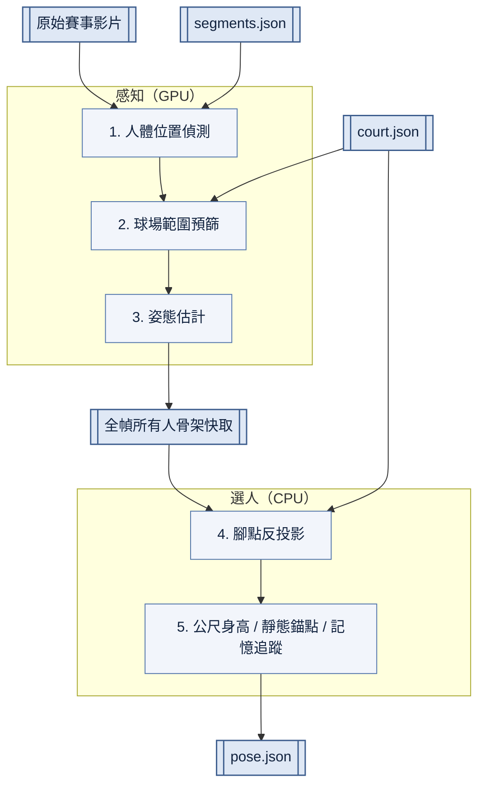

#### 感知：人體偵測與姿態估計

第一階段為片段的每一幀還原畫面上所有人的骨架並快取，是整個模組的 GPU 時間瓶頸。先用人體偵測器（YOLOX）框出所有人，再採由上而下路線逐人裁切、放大回模型輸入尺寸後在滿解析度下估骨架（RTMPose），讓很小的球員仍能得到準確的關節點。由於逐人估骨架的成本隨人數線性成長，而每幀偵到的十幾二十人裡真正相關的只有兩到四人，估骨架前先借單應性把每個人的腳點反投影回球場座標，只讓落在放寬球場範圍內者進入姿態模型。

<figure>
  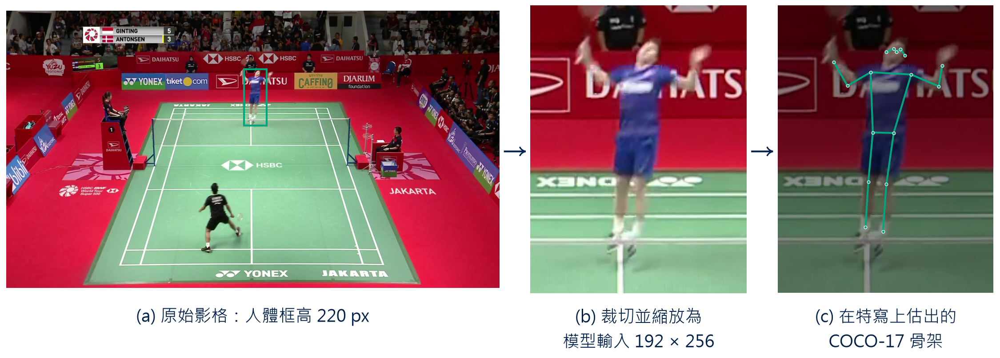
  <figcaption>由上而下，先裁切放大再估骨架</figcaption>
</figure>

#### 選人：腳點與球網分半

第二階段在快取好的骨架上以純幾何認出 `top`、`bottom` 兩名球員。把每個人化約為一個雙踝中點，經單應性反投影落到正規化球場座標。每一半內通過球場邊界的候選人可能不只一個，因此需要以下的排名與排除準則挑出球員。

**公尺身高排名：** 不能直接選最高的人，像素高度會被透視扭曲。因此先借單應性量出畫面上每點「一公尺對應多少像素」，把候選人放到同一真實尺度上比身高。

**非對稱邊界放寬：** 單應性只在地平面上成立，球員起跳殺球時腳踝離地，反投影會把腳點推到底線之外。為此把場內範圍在底線方向（縱向）放寬、邊線方向（橫向）收緊。

<figure>
  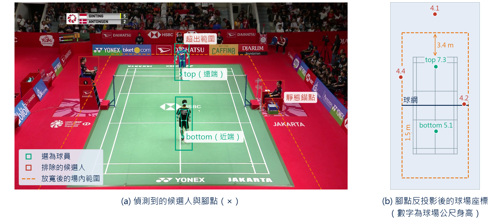
  <figcaption>腳點反投影至球場座標</figcaption>
</figure>

**靜態錨點排除干擾：** 尺寸與邊界仍擋不住一種情形，站在底線後、身高又與遠端球員相當的裁判，一旦真球員該幀被漏偵便可能頂替上來。關鍵在於是否移動，官員整場腳點落在同一處，球員則掃過整個球場。統計整場每個候選人的腳點落點，把在很高比例的幀裡被占用且幾乎不動的格子標為靜態錨點，之後腳點離錨點太近的候選人一律拒絕。

<figure>
  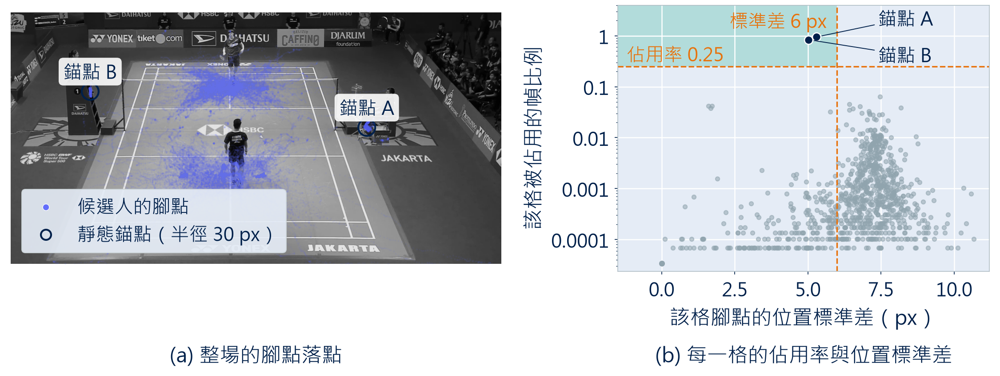
  <figcaption>整場腳點落點，固定不動者被判為靜態錨點</figcaption>
</figure>

**有記憶的連續追蹤：** 逐幀獨立選人仍會偶爾跳錯人，故改用帶短期記憶的追蹤器，有記憶時選離「上一幀所在位置」最近的人。記憶過舊即作廢，下一幀重新起始時無前一位置可依靠，便退回用公尺身高挑最高者。連續性成為依據，把漏偵時誤選裁判的風險壓到最低。


## 球體分析
### 球體追蹤與軌跡重建

#### 概述

**問題與目標：** 本模組為每個固定機位比賽片段重建羽球在畫面中的逐幀位置，作為下游擊球時刻偵測與球種分類的基礎。難點在於目標小、速度快，且球常被球員、球拍與球網遮擋。

**設計重點：** 本模組沿用預訓練的 TrackNetV3，並利用時間連續性與運動約束，改善單幀偵測的誤判與缺失，主要有三點做法：

1. **多候選軌跡搜尋：** 以低門檻保留每幀多個候選，再用 Viterbi 找出整段最連貫的路徑，使微弱但連續的真球能排除高信心的孤立誤偵。
2. **互補雙軌跡：** 同時輸出覆蓋率較高的 InpaintNet 軌跡與較保守的 Viterbi 軌跡，供下游依任務分工使用。

**處理流程總覽：**

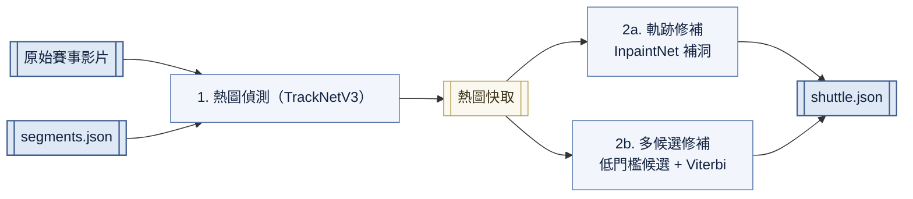

#### 熱圖偵測與快取

第一階段要在極小又易與背景混淆的目標上給出可靠證據。系統使用 TrackNetV3 對連續影格進行推論，產生逐幀信心熱圖。熱圖能保留多個可能位置，使後續方法可利用時間連續性決定最合理的軌跡。由於熱圖推論是主要的 GPU 運算，系統將結果按片段快取，使 InpaintNet 與 Viterbi 能共用相同的偵測結果，並可在不重新推論的情況下反覆調整軌跡重建方法。


先以 largest-blob 讀出一條基準軌跡——用信心門檻二值化後取面積最大的連通區塊，以其中心為位置、區塊峰值為該幀信心——這條基準軌跡是修補法的輸入，而選擇法另從同一份熱圖以低門檻自取候選（見下）。

<figure>
  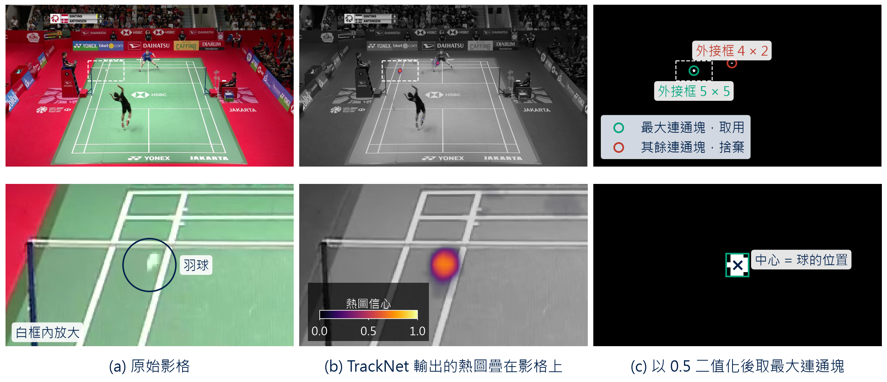
  <figcaption>從熱圖以 largest-blob 讀出基準軌跡</figcaption>
</figure>

#### 軌跡修補（InpaintNet）

第一種方法先將熱圖二值化，取每幀面積最大的連通區塊作為基準位置，再由補洞網路（InpaintNet[1]）補回遮擋造成的缺幀。補值點的信心標為 0，使下游能區分實際偵測與模型推論。

<figure>
  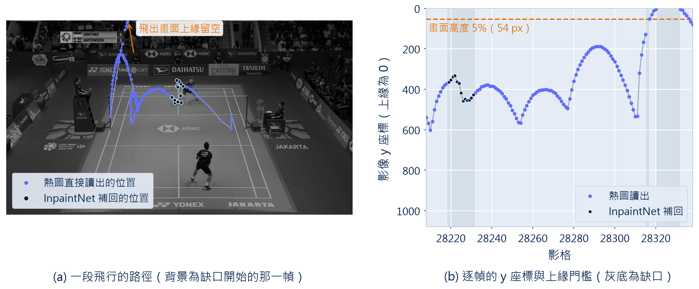
  <figcaption>補洞前後路徑差異，被遮擋的缺口補回，飛出畫面上緣的缺口留空</figcaption>
</figure>

#### 多候選軌跡修補（Viterbi）

第二種方法改以全域路徑搜尋壓制孤立誤偵。它用極低門檻把每幀所有稍可能是球的區塊全留作候選，再找一條最像真實飛行的路徑穿過它們。把每幀候選當節點、相鄰候選間連邊，給節點獎勵（信心越高越好）、給邊代價（前後兩點推出的速度越不合物理越貴、跨幀越多越貴），以動態規劃取總分最高的路徑。如此微弱但連貫的偵測能勝過強烈但孤立的偵測。當某幀球員鞋子或場線在信心上壓過真球，只要接不上前後飛行就不會入選。最後才對剩餘缺口依長度與兩端運動狀態決定補或不補，並以卡爾曼濾波填值。

<figure>
  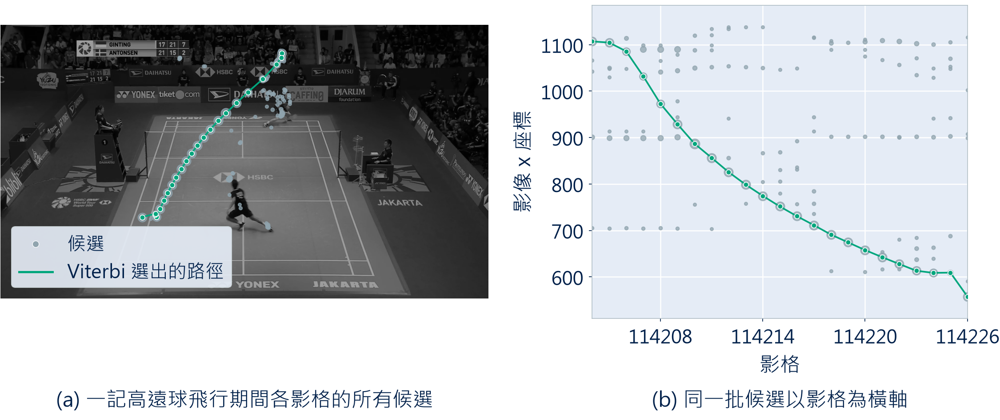
  <figcaption>低門檻多候選與 Viterbi 選出的最佳路徑</figcaption>
</figure>

#### 雙軌跡並存

修補法與選擇法各有所長、在不同情境下互有勝負，模組因此不在內部挑出贏家，而是把兩條軌跡都算出、都寫進 `shuttle.json` ，把選擇交給握有更多上下文的下游。

### 擊球時刻偵測

#### 概述

**問題與目標：** 本模組在每個片段內標記出每一擊球的影格，為下游球種分類提供窗口範圍。

**設計重點：** 本模組的初始版本參考了開源專案 SoloShuttlePose 的擊球事件偵測（`event_detect`）[4]，其僅以單條球體軌跡的 Y 軸峰值與軌跡轉角判定擊球。現行版本在其基礎上重新設計，改以多源證據融合與結構性補漏取代單一軌跡幾何。一次擊球是軌跡上一瞬間的事件，只在球路上留下細微痕跡，任何單一訊號都不夠可靠。本模組因此同時融合多種訊號，並以召回優先，把不漏拍作為首要目標。主要有兩點做法：

1. **多源證據融合：** 不押注單一訊號，同時利用兩條球體軌跡、球員骨架與逐幀球種模型三種來源。相對於只讀軌跡幾何的做法，任一來源在特定情境失效時仍能由其他來源補上。
2. **結構性補洞：** 不靠放寬偵測門檻加球，而是從「結構上一定有一拍」的位置（交替違規、模型長時間鎖定、發球遮擋）反推漏拍位置。

在 8 場未參與開發的比賽上，本模組在 ±5 影格容差下召回率 90.90%、精確率 95.49%，配對成功的擊球時間誤差中位數為 −1 影格，即比真值早 1 影格（見[實驗結果](#四實驗結果)）。

**處理流程總覽：**
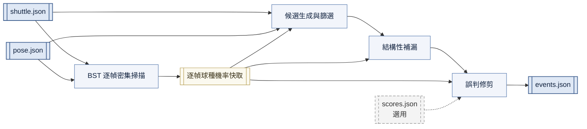

#### 逐幀球種證據

本模組先對每個片段逐影格掃描，將每個影格前後各半秒的窗口，輸入球種分類模型 BST [2]，得到該影格的 25 類球種機率分布。

BST 原本設計的窗口是「兩次擊球之間」，需要以擊球時刻作為窗口邊界。但在本模組，擊球時刻正是需要偵測的目標。因此本模組將所有影格以固定窗口輸入模型，並將輸出反過來作為是否存在擊球的判斷依據之ㄧ。BST 的輸出提供三種輔助證據：

**球種信心：** 若模型對某個影格的窗口給出高信心的球種判斷（例如 0.9 的殺球），代表這個窗口的球路與骨架很接近某個真實擊球的樣態。相較於另一個最高信心僅 0.3 的窗口，前者更可能對應到一次真實擊球。

**擊球者判定：** 即使窗口沒對齊擊球，模型對「擊球者位於畫面上方或下方」的判斷仍相當可靠，比單純比較羽球與兩名球員的距離更為準確，因此在後續分邊時作為優先證據。

**連續球種區間：** 若把某個真實擊球影格前後半秒作為窗口輸入模型會得到球種 a，那麼對它鄰近的前後一兩影格做同樣的事，因窗口內容高度重疊，也極可能得到相同的球種 a，只是信心略低。反過來說，只要觀察到連續多個影格被判為同一球種，就代表該區間附近很可能存在一次擊球。

<figure>
  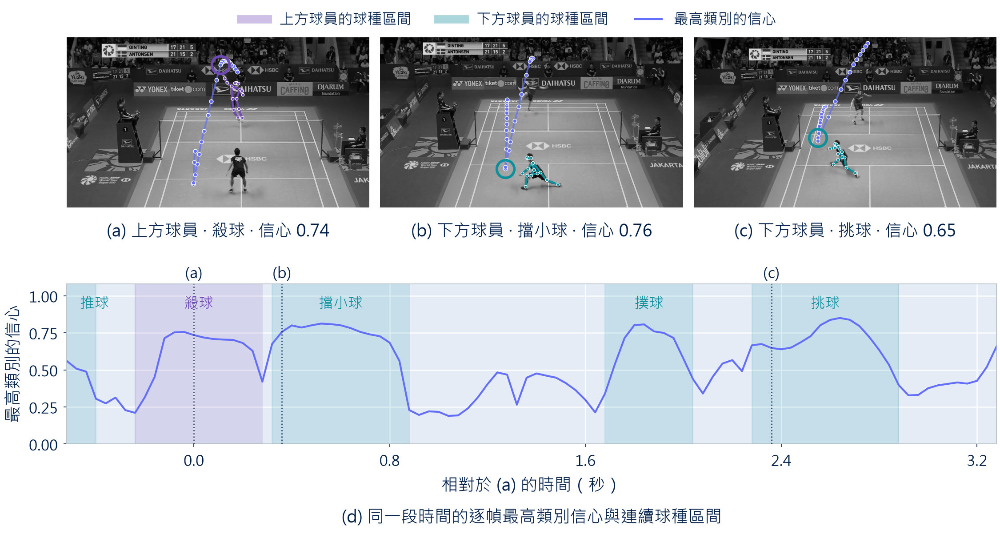
  <figcaption>逐幀滑動窗口產生的球種、信心與擊球者證據。(a)–(c) 為三次擊球的窗口球路與擊球者骨架，圈記為擊球時刻；下方時間軸為同一段窗口，真實擊球附近會形成連續的同球種高信心區間</figcaption>
</figure>

#### 候選生成

本步驟分析軌跡中實際存在的有效點。由於不同球種在軌跡上的差異很大，不同位置擊球也會造成軌跡產生不同變化，因此單一訊號無法抓出所有擊球。本步驟尋找下列互補的擊球特徵：

**垂直轉折：** 影像座標的 (y) 值向下增加，因此羽球下降至球員附近、擊球後重新上升時，會在軌跡上形成局部最大值。

**方向與速率突變：** 比較候選前後的速度向量，若方向明顯轉折且速率比例突然改變，較可能是球拍接觸，而非重力造成的平順轉彎。

**由慢轉快：** 平抽或快速推球未必形成明顯垂直轉折，因此另以擊球前後的速率比及水平速度變化尋找候選。

**發球錨點：** 額外偵測回合開頭的陡峭垂直變化與第一段持續上升軌跡，作為發球候選。

本步驟刻意偏向敏感、高召回，先保留不確定候選，再交由後續規則排除。擊球時刻要用來為下一階段的球種模型切分析窗口，一旦漏掉一拍，窗口就會整段錯位，後續的比賽脈絡也會出現難以復原的斷點。

<figure>
  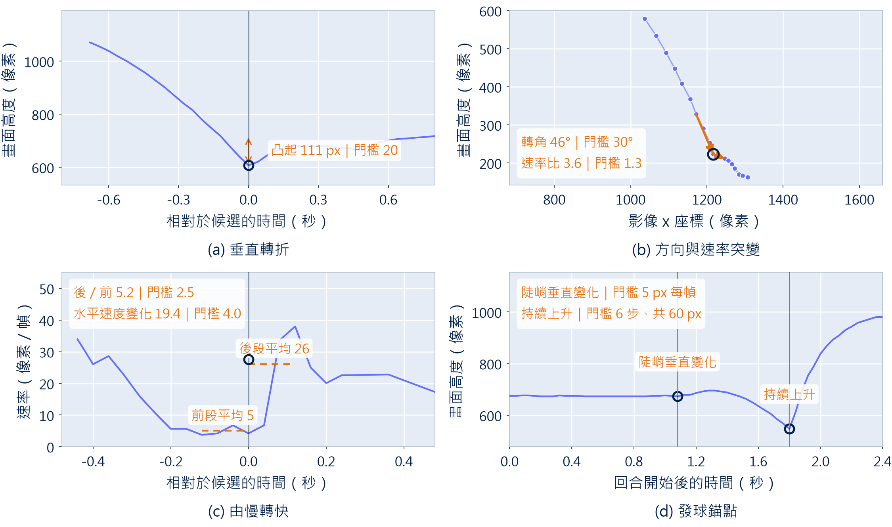
  <figcaption>四種互補的擊球候選訊號。(a) 弧線底部的凸起、(b) 擊球前後速度向量的轉角與速率比、(c) 擊球前後的速率變化、(d) 回合開頭的兩個發球錨點</figcaption>
</figure>

<figure>
  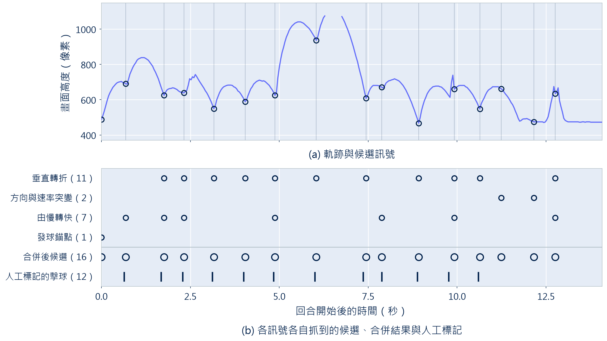
  <figcaption>各訊號在完整回合中的候選分布與合併結果。(b) 中沒有任何單一訊號涵蓋全部人工標記，合併後的候選則全部涵蓋，但也多出數個回合結束後的候選</figcaption>
</figure>

#### 候選篩選

本步驟將候選經過三道篩選：

**位移振幅：** 計算候選附近時間窗內的水平與垂直位移範圍，只要其中一軸具有足夠位移便予以保留，以排除球落地後的微小追蹤抖動。

**同球員去重：** 依靠 BST 的輸出判定擊球者，若時間相近的連續候選被判為同球員擊球，通常代表一次擊球同時觸發多種軌跡訊號。系統只保留水平與垂直位移振幅總和較大的候選。

**回合脈絡：** 已知擊球側的候選附近應能找到對側球員的其他擊球候選。目前規則要求在指定時間窗內至少存在兩個對側候選，否則將其視為落地彈跳、追蹤脫線或其他孤立訊號。

<figure>
  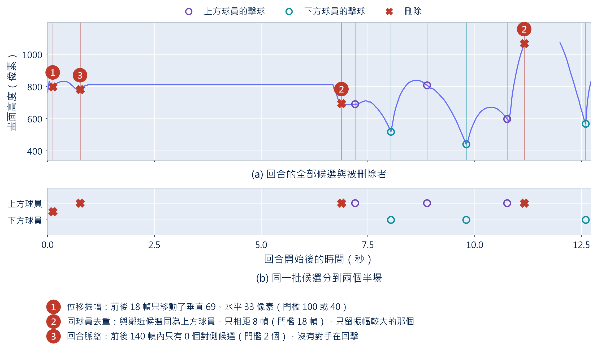
  <figcaption>三道候選篩選規則及其保留／刪除結果。(a) 為一個回合的全部候選，被刪掉的三個標上編號；(b) 為同一批候選分到兩個半場，孤立的候選在對面半場找不到人回擊；編號的理由列在圖下</figcaption>
</figure>

#### 結構性補漏

單靠放寬候選門檻會同時增加大量誤判，因此本步驟只在回合結構或多源證據顯示「此處很可能漏了一拍」時加入擊球。補漏刻意安排在候選篩選之後，序列先經篩選、去除雜訊後較為乾淨，回合脈絡才判斷得準，也才能據此救回一些訊號微弱、難以直接偵測的球。四條補漏規則依序執行，且新加入的擊球不得與既有擊球過近。

**交替違規補漏：** 若序列中相鄰兩拍均由同球員擊出，代表兩者之間可能漏掉一拍對側擊球。系統依序搜尋主軌跡上較弱的垂直或水平轉折，以及 BST 的對側高信心連續區間，找到足夠證據後才補一拍。

**未被認領的鎖定區間：** 若 BST 長時間、高信心地維持同一球種，但附近沒有任何擊球，系統會在該區間內尋找通過振幅條件的弱垂直轉折。BST 在此只指出可能漏拍的區域，不單獨決定擊球影格。

**輔助軌跡救援：** 球體追蹤模組除了主軌跡，另輸出一條 Viterbi 軌跡見[球體追蹤與軌跡重建](#球體追蹤與軌跡重建)，能看到主軌跡因遮擋或過度平滑而漏掉的球。若這條輔助軌跡在某處偵測到候選，且該候選接近 BST 球種訊號的起點、具有足夠信心，便將它加入。

**近端發球補漏：** 畫面下方球員發球時，部分軌跡可能被身體遮擋。若持續上升錨點附近尚無擊球，而 BST 同時提供下方球員的發球證據，系統便在附近被篩掉的候選中選擇最接近者。

<figure>
  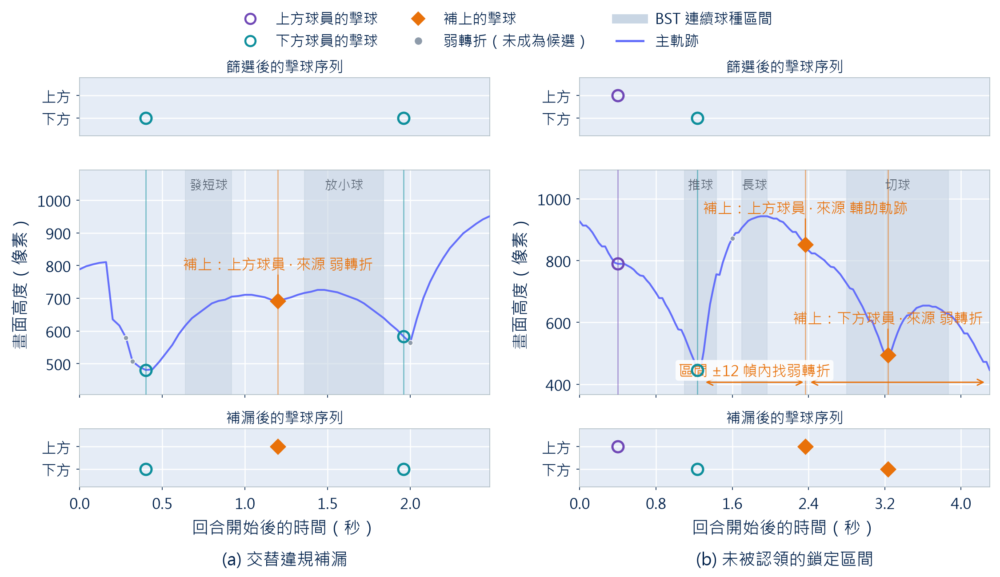
  <figcaption>由擊球序列與連續球種證據反推漏拍位置。(a) 相鄰兩拍同側、(b) 高信心球種區間內沒有擊球；兩者都再由弱轉折定出補上的位置</figcaption>
</figure>

<figure>
  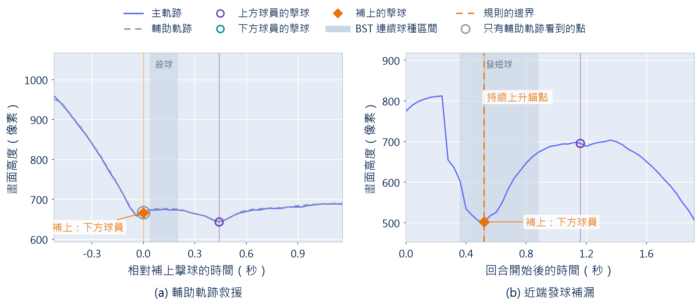
  <figcaption>由輔助軌跡與發球錨點救回主軌跡漏拍。(a) 只有輔助軌跡看到的點落在球種訊號起點上，(b) 近端發球以持續上升錨點與下方球員的發球證據補回</figcaption>
</figure>

#### 誤判修剪

本步驟清理回合邊緣不屬於實際對打的少數雜訊。僅針對三種很特定、平時不常觸發的情況：

**回合有效區間：** 發球前場上還沒有球在移動，球體追蹤可能把反光亮點之類誤認成球，生出不存在的球路，需剔除。

**尾段落地球：** 回合結束後，羽球的彈跳與滾動仍可能產生軌跡轉折，需剔除。

**計分板死時間：** 特定休息比分下的計分板死時間（如開局 0:0、局中技術暫停）。

<figure>
  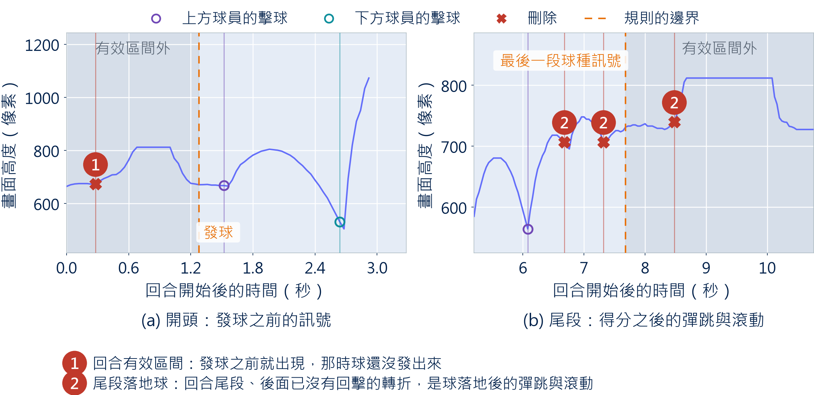
  <figcaption>利用回合有效邊界清除開頭誤偵與尾段落地球。(a)(b) 為兩個完整回合，橘色區間是回合的有效範圍，灰色是範圍之外；被刪掉的擊球標上編號，理由列在圖下</figcaption>
</figure>

<figure>
  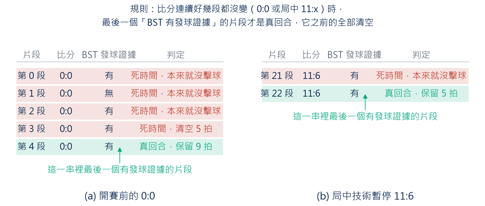
  <figcaption>結合比分與發球證據判定計分板死時間。每個片段只看比分與有無發球證據兩件事，同一個休息比分的連續片段中，最後一個有發球證據的才是真回合；(a) 為開賽前的 0:0，(b) 為局中技術暫停</figcaption>
</figure>

### 球種分類

#### 概述

**問題與目標：** 本階段根據每一次擊球前後的球員姿態、場上位置與羽球軌跡，判斷擊球者及球種。

**設計重點：** 球種分類器採用預訓練的 Badminton Stroke-type Transformer（BST）[2]，本專題不重新訓練或修改其模型架構。BST 解決的是「已知擊球時刻及各項結構化特徵後，如何判斷球種」。本專題在球種分類上的重點在於，利用前述各模組，自動從原始比賽影片產生 BST 所需的全部輸入。

**處理流程總覽：**


#### 分類流程

系統先將每個擊球時刻歸入對應回合，再依 BST 預訓練權重所使用的方式，以相鄰擊球時刻切出分析窗口。窗口內的球員骨架、場上位置與羽球軌跡會按照 BST 的資料格式進行正規化，並統一整理為 100 幀的輸入序列。

整理後的資料送入預訓練 BST，模型輸出 25 類機率，將結果依賽評需求整理為 8 類：高遠球、發球、小球、平快球、殺球、切球、撲球與勾球。若模型輸出未知類別，系統保留為未知。

<figure>
  
  <figcaption>依相鄰擊球時刻建立 BST 的 100 幀輸入窗口。(a) 窗口從上一拍延伸到下一拍之後，相鄰窗口彼此重疊；(b)–(d) 為窗口內的球員骨架、場上位置與羽球軌跡</figcaption>
</figure>

<figure>
  
  <figcaption>BST 的 25 類預測。類別名稱同時給出擊球者與基礎球種，取最高機率的一類後再改名為報告用的 8 類；第二名的放小球同樣會改名為小球，但機率不會與第一名相加</figcaption>
</figure>

## 音訊與精彩度分析

### 歡呼音訊量測

#### 概述

**問題與目標：** 視覺模組能說明每一拍發生了什麼，卻無法判斷哪個回合最讓現場有反應。觀眾歡呼是轉播中現成的精彩度訊號。本模組以分段模組產生的每個片段為範圍，量測片段結束前後是否出現歡呼及其相對強度，作為精彩片段排序的依據。

**設計重點：** 本模組不從頭訓練音訊模型，而是以凍結的 YAMNet [10] 擷取通用音訊特徵，只在其上訓練一個輕量的邏輯迴歸分類器，因此 400 個人工標註窗口就足以完成訓練。歡呼多在回合結束的瞬間爆發，所以讀取範圍會延伸到片段結束後 3 秒。分類與強度分開估計：分類器判斷窗口裡有沒有歡呼，響度則衡量歡呼有多大聲，兩者再各自聚合為每個片段一筆量測。音訊只是視覺分析的補充，不建立或覆寫擊球、球種、比分與球員身分等競賽事實，缺少音訊時，其餘模組仍照常運作。以 4 場比賽逐場交叉驗證，窗口層級歡呼偵測的 macro F1 為 0.827、ROC-AUC 為 0.957（見[實驗結果](#跨比賽歡呼偵測結果)）。

**處理流程總覽：**


#### 音訊切窗

系統先將音訊統一轉為 16 kHz 單聲道。對片段 \(s\)，分析起點等於片段起點，終點則延伸到片段結束後 3 秒，並以影片長度為上限：

\[
A_s^{start}=S_s^{start},\qquad
A_s^{end}=\min(S_s^{end}+3,\;T_{media}).
\]

延伸的原因是歡呼往往在回合結束時才開始，並在片段結束後持續數秒。分析範圍以 3 秒窗口切分，相鄰窗口的 hop 為 1 秒，只保留完整落在範圍內的窗口，尾端不足 3 秒的窗口直接捨棄。相鄰片段各自切窗，因此兩者的窗口可能重疊。

<figure>
  
  <figcaption>片段音訊的讀取範圍與切窗。(a) 回合進行中只有零星的擊球聲，歡呼在片段結束前後爆發，並延續到後置延伸內；(b) 每 1 秒取一個 3 秒窗口，最後一個超出讀取範圍而捨棄</figcaption>
</figure>

#### 歡呼分類

每個 3 秒窗口輸入凍結的 YAMNet [10]。YAMNet 以 AudioSet [11] 音訊事件資料預訓練，對一個窗口輸出多個時間切片的 1024 維特徵向量（patch embedding），系統取其平均作為窗口的固定長度表示：

\[
\mathbf{e}_i=\frac{1}{K_i}\sum_{k=1}^{K_i}\mathbf{z}_{i,k},
\qquad \mathbf{e}_i\in\mathbb{R}^{1024},
\]

其中 \(\mathbf{z}_{i,k}\) 為第 \(i\) 個窗口的第 \(k\) 個時間切片特徵，\(K_i\) 為切片數。平均向量經標準化後送入邏輯迴歸，輸出窗口的歡呼分數 \(p_i\in[0,1]\)；\(p_i\ge 0.5\) 的窗口視為正例窗口。

本系統不直接使用 YAMNet 原生的 Cheering 類別分數。在相同的逐場交叉驗證下，原生分數的 ROC-AUC 只有 0.839，以特徵向量訓練的分類器則為 0.957（見[實驗結果](#跨比賽歡呼偵測結果)）。歡呼分數是分類器的輸出，未經機率校準，只用於門檻判斷與排序，不應解讀為歡呼發生的機率。

#### 歡呼強度估計

同樣被判為歡呼，全場起立的喝采與零星掌聲在響度上可能差很多。因此系統另以窗口波形 \(x_1,\ldots,x_N\) 的均方根（RMS）衡量響度：

\[
RMS_i=\sqrt{\frac{1}{N}\sum_{n=1}^{N}x_n^2},
\]

\[
L_i=20\log_{10}(RMS_i+10^{-12}).
\]

不同轉播的錄音音量差異很大，絕對響度無法跨比賽比較，因此系統只在單場比賽內比較。將全場 \(M\) 個正例窗口的 \(L_i\) 由小到大排名（從 0 起算，同值取平均排名），再除以 \(M-1\) 映射到 \([0,1]\)，得到窗口的歡呼強度 \(r_i\)。全場只有一個正例窗口時，強度定為 0.5。負例窗口不計算強度。\(r_i\) 表示這個窗口在本場所有歡呼中的響度排名，而不是實際音壓。

#### 片段層級聚合

每個片段約有十多個窗口，需要聚合為一筆量測。歡呼通常只占片段的最後幾秒，取平均會被前段大量的安靜窗口稀釋，取最大值則容易被單一誤判窗口左右。系統因此折衷採用線性內插的第 95 百分位數（p95）。令 \(W_s\) 為片段 \(s\) 的全部窗口、\(W_s^+\) 為其中的正例窗口：

\[
C_s=Q_{0.95}^{linear}(\{p_i\mid i\in W_s\}),
\]

\[
I_s=
\begin{cases}
Q_{0.95}^{linear}(\{r_i\mid i\in W_s^+\}), & |W_s^+|>0,\\
\mathrm{null}, & |W_s^+|=0,
\end{cases}
\]

\[
N_s=|W_s^+|.
\]

\(C_s\) 為片段歡呼分數，聚合片段內全部窗口；\(I_s\) 為片段歡呼強度，只聚合正例窗口，沒有正例時為空值；\(N_s\) 為正例窗口數。由於窗口彼此重疊，\(N_s\) 不等於獨立的歡呼次數。各聚合方法的比較見[實驗結果](#segment-聚合方法選擇)。

### 精彩片段排序

#### 概述

**問題與目標：** 本模組把每個片段的歡呼量測合成一個精彩度分數，將整場比賽的片段由精彩到平淡排序，供回看介面標示重要回合，也作為賽評生成的選用背景訊號。

**設計重點：** 目前沒有人工標註的精彩片段真值可供訓練，因此精彩度分數採用透明的固定公式，而不是學習得到的模型。沒有歡呼的片段，強度以 0 計：

\[
I_s^{effective}=
\begin{cases}
I_s, & I_s\neq\mathrm{null},\\
0, & I_s=\mathrm{null}.
\end{cases}
\]

\[
H_s=0.5C_s+0.5I_s^{effective}.
\]

分數相同時，依片段歡呼分數、再依片段先後排序。0.5／0.5 的權重只表示等量結合「有沒有歡呼」與「歡呼多大聲」，並非最佳化的結果。由於強度是單場內的相對量，精彩度分數也只能在同一場比賽內比較。

**處理流程總覽：**


## 使用者介面

### 概述

**問題與目標：** 前述各模組的輸出是十多份 JSON 檔，記錄每個回合的起訖、比分、球員骨架、羽球軌跡等。這些資料必須對照影片才看得懂，直接閱讀數字既無法判斷分析是否正確。本系統的使用者介面讓使用者不必操作指令列，就能完成「匯入影片、執行分析、對照影片回看結果」的完整流程，並把逐拍資訊疊回轉播畫面，讓分析結果可以被直接檢視。

**使用流程總覽：**


比賽庫列出比賽資料夾中的每一場比賽及其分析狀態。尚未分析的比賽從「分析設定」選擇要執行的項目，分析在背景執行，完成後回看資料自動更新。已在其他環境完成分析的比賽，則可直接匯入既有結果，不需重新計算。

<figure>
  
  <figcaption>比賽庫，每場比賽標示分析狀態與是否可回看</figcaption>
</figure>

<figure>
  
  <figcaption>分析設定，每個分析項目標示已完成、未執行或已過期</figcaption>
</figure>

### 回看工作區

回看工作區是介面的核心，由播放器、回合分析欄與時間軸三個區域組成。三者共用同一個影片時間，任一區域的操作都會同步反映到另外兩區。

<figure>
  
  <figcaption>回看工作區。① 播放器與疊圖 ② 回合分析欄 ③ 時間軸</figcaption>
</figure>

#### 播放器與疊圖

播放器在轉播畫面上疊加各模組的分析結果，共 7 個圖層：球場線、骨架、選手標籤、羽球、球路拖尾、擊球閃圈與球種標籤。各圖層可以單獨開關，讓使用者直接用眼睛檢查各模組的結果，例如球場線是否貼合場地、骨架是否選對球員、軌跡是否跟著球走。圖層預設全部關閉，避免干擾一般觀看，需要時以 `O` 鍵開關整組疊圖、以 `1`–`7` 鍵切換個別圖層，也可以按 `V` 隱藏影片、只看疊圖。

完整轉播中，回合只佔播出時間的約三成。「只播片段」模式（`S` 鍵）會自動跳過回合之間的重播、休息與觀眾畫面，只播放分段模組切出的比賽片段。

<figure>
  
  <figcaption>疊圖開啟前後。(a) 原始轉播畫面 (b) 開啟全部圖層</figcaption>
</figure>

#### 回合分析欄

分析欄顯示目前回合的逐拍資訊，分為「回合」與「擊球點」兩個分頁。

- **擊球序列：** 依序列出每一拍的擊球者與球種，信心度低於 0.5 的球種以淡色加問號標示。點選任一拍，影片即跳到該拍的擊球時刻。
- **精華標記：** 精彩度排名在全場前 10% 的回合，會在欄位頂端顯示排名徽章。
- **單回合賽評：** 賽評不預先為整場比賽產生，而是由使用者在想看的回合按下「產生這回合的賽評」，每次約使用 3–4 次 Gemini 請求。產生後，回合摘要下方以「依據 #1、#2…」列出摘要所引用的擊球，點選即跳到該拍。逐拍賽評則附在擊球序列的每一拍下方，讓使用者能逐句對照影片確認賽評是否有所本。
- **擊球點：** 以俯視球場標出本回合每一拍的擊球位置，依擊球順序連線，顏色區分兩名球員，可一眼看出回合中雙方的跑動與落點分布。

<figure>
  
  <figcaption>回合分析欄。(a) 擊球序列與精華排名 (b) 產生賽評後 (c) 擊球點分頁</figcaption>
</figure>

#### 時間軸

時間軸提供四種模式，各自呈現一種隨時間變化的分析結果。

- **片段：** 每個片段一根長條，高度為回合長度，並以 G1–G3 標示局數。
- **擊球：** 依每片段的球種組成著色。
- **比分：** 呈現雙方比分差距隨時間的變化，位於中線上方表示選手 A 領先、下方表示選手 B 領先。
- **歡呼：** 顯示各片段的歡呼訊號，並以三角形與數字標示精彩度排名。

<figure>
  
  <figcaption>時間軸的四種模式（全場尺度）。(a) 片段 (b) 擊球 (c) 比分 (d) 歡呼</figcaption>
</figure>

時間軸可在「全場」與「單片段」兩種尺度間切換。全場尺度用於掌握整場比賽的分布與走勢。雙擊任一片段即放大到該回合，此時每一拍成為一個點並標上球種縮寫，可以看出來回的節奏。使用者也可以滾輪平移、`Ctrl`＋滾輪自由縮放。

<figure>
  
  <figcaption>擊球模式在兩種尺度下的呈現。(a) 全場 (b) 單回合</figcaption>
</figure>

播放、導覽、疊圖與時間軸的操作都有對應的鍵盤快捷鍵，按 `H` 即可叫出完整說明。

### 分析任務與場地校正

**分析計畫預覽：** 使用者勾選分析項目並按下「開始分析」後，介面先列出執行計畫：哪些階段會執行、哪些沿用既有結果及其原因，以及計畫是否會呼叫 Gemini API。若某些未勾選階段的上游結果會因這次分析而改變，介面也會列出這些將會過期的階段，回看時不會顯示過期的資料。

<!-- 待補截圖：按下「開始分析」後的執行計畫預覽畫面 -->

**任務進度：** 分析在獨立的背景程序中執行，關閉介面不會中斷分析。任務頁顯示整體進度、各階段耗時與詳細記錄，使用者也可以隨時取消，取消時已完成的階段會保留，下次分析只需從中斷處繼續。

<figure>
  
  <figcaption>任務進度，顯示整體與各階段的進度及詳細記錄</figcaption>
</figure>

**場地校正：** 場地偵測失敗或角點不準時，使用者可以在分析設定頁的「場地校正」中，直接在球場畫面上拖曳四個外角修正位置，並以方向鍵逐像素微調。

<figure>
  
  <figcaption>場地校正，拖曳四個外角對齊球場邊線</figcaption>
</figure>

### 實作概要

介面以 Vue 3 與 TypeScript 開發，並以 Electron 包裝為 Windows 桌面程式。分析本身仍由本機的 Python 服務執行，介面只負責送出分析任務與顯示進度。分析完成後，匯入程式會先驗證各階段的 JSON 是否完整、是否與影片相符，再整合成一份回看資料，介面只讀取這一份資料，不直接讀取各階段的原始輸出。骨架、軌跡等資料量較大的疊圖內容則按回合分開儲存，只在使用者打開疊圖時才讀取目前與下一個回合，避免開啟比賽時長時間等待。


# 四、實驗結果
## 資料集與重現方式
本章視覺模組的實驗共用下述影片庫；音訊模型另使用四場開發比賽與一場偵測器外部驗證，資料角色與結果另列於「歡呼偵測與精彩度分析」，不假設兩套 match ID 或分割相同。資料集由 16 支 YouTube 羽球單打完整轉播構成，涵蓋 2018 至 2023 年的國際賽事。影片皆為 1920 × 1080，幀率為 25 或 30 fps，編碼格式包含 H.264、AV1 與 VP9。全部影片合計 1,704,001 個影格、約 18.09 小時。為避免同一場比賽的資料同時出現在開發與評估中，資料以影片為單位切分為 7 場開發集與 9 場測試集；開發集用於設計與調整規則，測試集不參與開發，僅在完成後用於報告測試結果。由於其中 15 支影片來自 BWF 官方製作，跨轉播單位的泛化能力仍待後續驗證。

| 資料分割 | 影片數 |    影格數 |
| -------- | -----: | --------: |
| 開發集   |      7 |   852,297 |
| 測試集   |      9 |   851,704 |
| 合計     |     16 | 1,704,001 |

為使影格編號可被他人重現，`experiments/dataset/videos.json` 與 `videos.md` 記錄每支影片的 YouTube 來源、解析度、幀率、影格數、編碼、SHA-256 雜湊及影格指紋。下載影片後，應先放至 `matches/<代號>/input/`，並執行下列指令確認檔案與標記時所用影片一致：

```powershell
uv sync
uv run python experiments/dataset/verify_video.py --all
```

驗證程式依序檢查檔案雜湊、影格數／幀率／長度，以及固定影格的畫面指紋。即使檔案經重新壓縮，只要影格序列相同仍可通過指紋檢查。

上述視覺實驗的影片對照資料及程式置於 `experiments/`。音訊研究的程式與凍結文件另在 `badminton-audio-highlight`，其本機 labels、features 與結果 JSON 尚未隨 Git 發布，重現限制另行說明。
## 各模組結果
### 賽事影片分段

在 9 場未參與開發的比賽、670 個真值片段上，本模組在 IoU ≥ 0.9 下達到 Precision 98.37%、Recall 98.96%，邊界誤差中位數為 0 影格。16 場、1354 個片段的整體 F1 為 99.01%，其中 11 場零錯誤。分段結果會直接決定下游分析範圍，因此本節分別驗證片段偵測、邊界精度，並分析所有失配案例。

真值、標記程式、評分程式與逐場結果皆公開於 `experiments/match_segmentation/`。

本模組的真值定義為「固定主機位之連續比賽畫面」的起訖影格，起訖兩端均包含。所有真值由同一位標記者完成。

#### 偵測準確率

配對規則為 IoU ≥ 0.9、一對一，未配對的輸出段計為 FP、未配對的真值段計為 FN。

| 比賽       | 真值 ans | 輸出 prog |  matched |     FP |     FN | Precision |    Recall |        F1 |
| ---------- | -------: | --------: | -------: | -----: | -----: | --------: | --------: | --------: |
| **開發集** |  **684** |   **687** |  **681** |  **6** |  **3** | **99.13** | **99.56** | **99.34** |
| **測試集** |  **670** |   **674** |  **663** | **11** |  **7** | **98.37** | **98.96** | **98.66** |
| **合計**   | **1354** |  **1361** | **1344** | **17** | **10** | **98.75** | **99.26** | **99.01** |

16 場中有 11 場零錯誤，全部 27 筆失配集中在 5 支影片上。

#### 邊界精度

誤差定義為「輸出 − 真值」，單位為影格，只計算配對成功的段。起點為正代表系統比真值晚開始（切掉了開頭），終點為負代表系統比真值早結束（切掉了結尾）。

| 比賽       | 起點中位數 | 起點 MAE | 起點最大偏移 | 終點中位數 | 終點 MAE | 終點最大偏移 |
| ---------- | ---------: | -------: | -----------: | ---------: | -------: | -----------: |
| **開發集** |   **+0.0** | **0.31** |       **+6** |   **+0.0** | **0.01** |       **−3** |
| **測試集** |   **+0.0** | **0.19** |       **+4** |   **+0.0** | **0.05** |      **−10** |
| **合計**   |   **+0.0** | **0.26** |       **+6** |   **+0.0** | **0.03** |      **−10** |

1344 個配對段中沒有任何一段的邊界誤差超過 10 影格。只要一個回合被完整切出來，它的邊界幾乎一定是準的。

#### 失敗案例與限制

27 筆失配可歸為三類，且各自集中於特定影片。其中漏掉表示回合未被完整切出，多切則表示產生額外片段。

| 成因                             |   多切 |   漏掉 | 影響的比賽                           |
| -------------------------------- | -----: | -----: | ------------------------------------ |
| 一、播報圖卡動畫把回合切成碎片   |     11 |      6 | TTY_vs_ASY_2023、test1、test2、test3 |
| 二、全域亮度變化使跨片段篩選失效 |      1 |      2 | test4                                |
| 三、門檻邊緣的高強度回合被切斷   |      5 |      2 | test6                                |
| **合計**                         | **17** | **10** |                                      |

**一、播報圖卡動畫。** 轉播在回合開始或結束時播放球員名條、比分卡等動畫，使 MAD 超過門檻，將回合切成碎片。動畫持續 3–6 秒，遠超過邊界精修可橋接的 12 影格，因此無法重新連接。

**二、全域亮度變化。** test4 開賽後前兩個回合整段消失。MAD 中位數與正常回合相近，表示門檻判斷本身沒有問題。真正失效的是跨片段一致性篩選。由於開賽初期場館燈光逐漸變亮，兩段畫面與其他回合雖然構圖相同，整體像素差卻明顯較高，因而被誤判為非比賽畫面。此類錯誤表現為整段消失，而非邊界偏移。

**三、門檻邊緣的高強度回合。** test6 有兩個高強度回合被切成數段，其中一個 11.4 秒的回合被切成三段。切斷處與保留區段的 MAD 均接近門檻，顯示球員劇烈移動使畫面差異在門檻附近波動。由於目前採用全片固定門檻，無法適應此類時間上的動態變化。

**已知但未在本資料集上觸發的限制。** 若影片包含大量且相似的非比賽畫面，跨片段一致性篩選可能失效。系統亦假設存在穩定主機位，不適用於手持或多機快切影片。此外，16 支影片中有 15 支來自 BWF 官方製作，因此跨轉播單位的泛化能力尚未驗證。

### 場地偵測

在 9 場未參與開發的比賽、36 個球場外角上，本模組的角點定位誤差中位數為 2.79 像素，命中率 72.22%，9 場中有 6 場四角全中。16 場、64 個外角的整體誤差中位數為 3.05 像素，命中率 76.56%，11 場四角全中。

真值、標記程式、評分程式與逐場結果皆公開於 `experiments/court_detection/`。

**真值定義。** 球場外緣是有寬度的白線，邊線與底線在外角交疊成一個小四邊形，本節稱為「角區」。標記時不直接點選角點，而是在合成圖上標出外框四條線各自的外緣與內緣，共 8 條邊緣，每個角區由相交的兩條底線邊緣與兩條邊線邊緣的 4 個交點構成。所有真值由同一位標記者完成。

#### 定位誤差

誤差定義為偵測角點到角區中心的歐氏距離，單位為像素。

| 範圍       |   角數 | 遠端中位數 | 近端中位數 | 全部中位數 |  全部平均 |   全部最大 |
| ---------- | -----: | ---------: | ---------: | ---------: | --------: | ---------: |
| **開發集** | **28** |   **0.97** |   **3.59** |   **3.34** | **31.95** | **395.72** |
| **測試集** | **36** |   **1.00** |   **4.83** |   **2.79** | **33.71** | **440.27** |
| **合計**   | **64** |   **1.00** |   **3.62** |   **3.05** | **32.94** | **440.27** |

中位數與平均值相差十倍，顯示誤差分布呈兩極，多數角點的誤差只有數像素，少數完全失敗的角則偏離數百像素。近端的像素誤差大於遠端，推測是鏡頭畸變使部分影片中近端底線彎曲造成。

#### 命中率

命中定義為偵測角點落在角區內，或在角區外緣 2 像素容差內。

| 範圍       |   場數 |  遠端命中 |  近端命中 |  全部命中 |    命中率 | 四角全中場數 |
| ---------- | -----: | --------: | --------: | --------: | --------: | -----------: |
| **開發集** |  **7** | **11/14** | **12/14** | **23/28** | **82.14** |      **5/7** |
| **測試集** |  **9** | **14/18** | **12/18** | **26/36** | **72.22** |      **6/9** |
| **合計**   | **16** | **25/32** | **24/32** | **49/64** | **76.56** |    **11/16** |

若不給容差、只計嚴格落在線寬內的角點，命中為 33/64（51.56%）。有 16 個角點落在角區外緣 2 像素內，這類偏移已小於一條白線的寬度，在後續換算球場座標時可視為已對準。

#### 失敗案例與限制

15 個未命中的角中，14 個來自同一根因，底線旁的地面廣告字樣在線段分群時與底線合併，導致代表線偏移。

| 成因                               | 未命中角數 | 到角區中心距離 | 影響的比賽            |
| ---------------------------------- | ---------: | -------------: | --------------------- |
| 底線被廣告字樣污染，收縮至內部矩形 |          8 |      17–440 px | CTC_vs_CL_2019、test5 |
| 底線被廣告字樣污染，外擴至字樣邊緣 |          6 |       17–70 px | test8、test6          |
| 遠端角輕微偏移                     |          1 |          10 px | ASG_vs_AA_2020        |
| **合計**                           |     **15** |                |                       |

**底線被廣告字樣污染。** 轉播場館常在場地墊印製贊助商字樣，距底線僅約 10–40 像素。由於字樣位於球場遮罩內，白色字母會被視為線像素，並經霍夫轉換產生大量與底線平行的短線段，其方向正確，因此無法由消失點過濾排除。

將人工標記的真值四角直接代入同一套吻合度評分，test5 與 CTC_vs_CL_2019 分別得到 0.825 與 0.922，明顯高於實際錯誤解的約 0.45，顯示評分本身能辨識正確解，問題主要發生在**候選生成階段**。

進一步僅修改線段分群方式並重跑 16 場，將合併距離由 14 像素縮為 6 像素，或改以最長線段為錨點並依線段長度加權擬合，命中數皆由 49/64 提升至 61/64，且上述四場全部恢復命中。由於這些修正是在觀察測試集失敗後才提出，因此不能將修正後結果視為未參與開發的測試結果，修正列為後續改進方向。

**系統無法察覺自身失敗。** 三場四角全錯的比賽中，模組皆正常輸出四角與單應性，未標記為偵測失敗。原因是吻合度目前僅用於候選間比較，沒有絕對門檻判斷最佳解是否可信，因此錯誤結果仍會傳入下游模組。

**已知但未觸發的限制。** 本模組假設機位固定，且球場大致位於畫面中央偏下，並從該區域取樣參考色。若機位偏移使取樣區域落在場外，顏色分割可能整體失效。

### 擊球時刻偵測

在 8 場未參與開發的比賽、6990 拍上，本模組在 ±5 幀容差下達到 Precision 95.49%、Recall 90.90%，配對成功的擊球時間誤差中位數為 −1 幀。14 場、12163 拍的整體 F1 為 92.10%。

真值、評分程式與逐場結果皆公開於 `experiments/event_detection/`。

**真值來源。** 本模組的真值取自公開資料集 ShuttleSet [9]（MIT 授權），以原檔形式收錄。16 場中有 14 場在 ShuttleSet 內，因此本節的開發集為 6 場、測試集為 8 場。答案幀原樣使用，唯一的調整是 `test5` 與 `test8`，我們取得的影片版本開頭多出一段賽前畫面，整體差了整數分鐘（+15000 與 +12000 幀），先予補回。

**評分範圍。** 真值只涵蓋 ShuttleSet 收錄的回合，系統輸出也只存在於分段模組切出的片段內。因此只在兩者重疊的時間評分，以每個回合的第一拍到最後一拍（前後各放寬容差 tol）與片段取交集。全真值中有 97.9% 落在評分範圍內。

#### 偵測準確率

配對規則為偵測幀與答案幀相差 ≤ 5 幀、一對一，由相差最小者開始配對。未配對的偵測計為 FP，未配對的答案計為 FN。

| 比賽       |  真值 ans | 輸出 prog |   matched |      FP |       FN | Precision |    Recall |        F1 |
| ---------- | --------: | --------: | --------: | ------: | -------: | --------: | --------: | --------: |
| **開發集** |  **5173** |  **4981** |  **4605** | **376** |  **568** | **92.45** | **89.02** | **90.70** |
| **測試集** |  **6990** |  **6654** |  **6354** | **300** |  **636** | **95.49** | **90.90** | **93.14** |
| **合計**   | **12163** | **11635** | **10959** | **676** | **1204** | **94.19** | **90.10** | **92.10** |

容差放寬或收緊時的變化如下：

| 容差（影格） | Precision | Recall |    F1 |
| -----------: | --------: | -----: | ----: |
|            3 |     89.07 |  84.16 | 86.54 |
|            5 |     94.19 |  90.10 | 92.10 |
|           10 |     95.68 |  92.65 | 94.14 |

#### 時間誤差

誤差定義為「偵測 − 答案」，單位為影格，只計算配對成功的擊球。

| 比賽       | 中位數 |      平均 |      MAE |
| ---------- | -----: | --------: | -------: |
| **開發集** | **−1** | **−1.46** | **1.80** |
| **測試集** | **−1** | **−1.15** | **1.55** |
| **合計**   | **−1** | **−1.28** | **1.66** |

以毫秒計，整體誤差中位數為 −40 ms，MAE 為 64.6 ms。多數擊球被系統抓在真值前 1 至 2 影格，推測是因為本模組偵測的是軌跡轉折點，而人工標記的是球拍接觸的畫面。

#### 失敗案例與限制

以下分析測試集的 636 個 FN 與 300 個 FP，根據失配前後 ±5 影格的模組內部紀錄，將失配依成因分類。

| 成因                     |      FN |      FP |
| ------------------------ | ------: | ------: |
| 抓到但時間差 6–10 影格   |     192 |     148 |
| 遠端擊球在影像中沒有轉折 |     159 |       — |
| 篩選與修剪規則誤刪       |     182 |       — |
| 發球未產生候選           |      63 |       — |
| 同一拍重複偵測           |       — |      74 |
| 其他                     |      40 |      78 |
| **合計**                 | **636** | **300** |

最大宗的失配為**時間偏移**，FN 的 30%、FP 的 49% 屬於系統已在正確位置附近偵測到，但與真值相差 6–10 影格，因此同一拍同時形成 FN 與 FP。將容差由 5 影格放寬至 10 影格後，F1 由 92.10% 提升至 94.14%，顯示部分誤差來自擊球時間定位差異。

FN 主要來自兩類。其一是**遠端擊球缺乏軌跡轉折**，部分遠端球員擊球時，球在影像中的運動方向未改變，僅速度微小改變，因此無法觸發以軌跡轉折為核心的候選訊號。其二是**候選遭後續規則刪除**，主要涉及同側去重、回合脈絡判斷與尾段修剪。

FP 則主要來自**同一拍的重複偵測**。同一擊球可能產生多個候選，若其擊球側判斷不同，現有去重規則無法合併。其餘補漏規則誤觸發與球體追蹤雜訊合計僅占少數。

本實驗的評分範圍只延伸至回合最後一拍後 5 影格，因此無法完整評估回合結束後落地彈跳造成的誤判，以及尾段修剪規則的實際效果。

### 球種分類

在 3 場 BST 未曾看過的比賽、1601 拍上，本模組的 8 類球種準確率為 87.38%，Macro-F1 為 84.71%，擊球者（上方／下方）準確率為 97.88%。若把擊球時刻偵測漏掉的拍也算錯，端到端準確率為 78.99%。

真值、評分程式與逐場結果皆公開於 `experiments/stroke_classification/`。

**真值來源。** 本節與擊球時刻偵測使用同一份 ShuttleSet 真值，評分範圍與配對規則也完全相同。ShuttleSet 的 18 種球種先依 BST 訓練時的方式併為 12 類，再併為系統輸出的 8 類。

**BST 看過的比賽。** 本模組使用的 BST 權重即以 ShuttleSet 訓練 [2]。依 BST 公開的切分，14 場中有 11 場屬於其訓練集，在這些比賽上量得的準確率可能偏高，只有 3 場未參與 BST 訓練。因此本節以這 3 場為主要結果，其餘 11 場僅作對照。

#### 分類準確率

| 範圍                   | 計分拍數 |  球種 Acc |  Macro-F1 | 端到端 Acc | 擊球者 Acc |
| ---------------------- | -------: | --------: | --------: | ---------: | ---------: |
| **BST 沒看過（3 場）** | **1601** | **87.38** | **84.71** |  **78.99** |  **97.88** |
| BST 看過（11 場）      |     9333 |     88.32 |     86.36 |      80.06 |      98.02 |
| 合計（14 場）          |    10934 |     88.18 |     86.22 |      79.90 |      98.00 |

BST 看過與沒看過的兩組只相差約 1 個百分點，可見在 BST 看過的比賽上量得的結果沒有明顯偏高。推測原因是 BST 訓練時的骨架與球軌跡由其原作者的流程產生，本系統則由自己的姿態與球體追蹤模組產生。

沒看過的 3 場各球種表現如下：

| 球種   | 真值拍數 | Precision | Recall |    F1 |
| ------ | -------: | --------: | -----: | ----: |
| 高遠球 |      531 |     92.28 |  90.02 | 91.13 |
| 發球   |       93 |     98.81 |  89.25 | 93.79 |
| 小球   |      387 |     95.03 |  88.89 | 91.86 |
| 平快球 |      136 |     59.63 |  70.59 | 64.65 |
| 殺球   |      174 |     87.85 |  91.38 | 89.58 |
| 切球   |      189 |     85.71 |  88.89 | 87.27 |
| 撲球   |       19 |     93.33 |  73.68 | 82.35 |
| 勾球   |       72 |     75.00 |  79.17 | 77.03 |

#### 上游影響

為區分錯誤來自擊球時刻還是 BST 本身，另將擊球幀換成真值的擊球幀重跑一次球種分類，其他輸入（骨架、球軌跡、場地、權重）不變。

| 擊球幀   | 計分拍數 | 球種 Acc | Macro-F1 | 擊球者 Acc |
| -------- | -------: | -------: | -------: | ---------: |
| 系統偵測 |     1601 |    87.38 |    84.71 |      97.88 |
| 真值     |     1771 |    88.54 |    84.98 |      98.54 |

即使擊球時刻完全正確，準確率也只提升 1.16 個百分點。

#### 失敗案例與限制

沒看過的 3 場中共有 202 拍判錯，依重跑結果分類如下：

| 成因                                 | 拍數 |
| ------------------------------------ | ---: |
| BST 本身判錯（換成真值擊球幀仍錯）   |  146 |
| 擊球時刻所致（換成真值擊球幀即正確） |   48 |
| 判成未知球種                         |    8 |
| 合計                                 |  202 |

BST 本身的錯誤集中在軌跡相近的球種之間。最多的是高遠球與平快球互判（49 + 26 拍），其次是小球與勾球（19 + 10 拍）和殺球與切球（14 + 10 拍）。

### 歡呼偵測與精彩度分析

#### 歡呼偵測資料集與評估方式

歡呼偵測任務以 3 秒窗口為單位，資料來自四場開發比賽。每場以固定 seed 42 的 segment-diverse deterministic sampling 選取 100 個窗口，再由人工進行 blind labeling。標註允許 ambiguous；二元分類資料會排除 ambiguous，本次四場凍結資料沒有 ambiguous 樣本。

| 資料集      |   Cheer | No cheer |    合計 |
| ----------- | ------: | -------: | ------: |
| `match_001` |      33 |       67 |     100 |
| `match_002` |      31 |       69 |     100 |
| `match_003` |      55 |       45 |     100 |
| `match_004` |      31 |       69 |     100 |
| **合計**    | **150** |  **250** | **400** |

評估採 Leave-One-Match-Out（LOMO）：每一 fold 以三場共 300 個窗口訓練，剩餘一場的 100 個窗口作為測試資料。StandardScaler 只在該 fold 的訓練資料上 fitting，再套用到 held-out match。相較隨機拆分窗口，此方法以 match ID 隔離訓練與測試資料，避免同場相鄰窗口分散到兩邊；目前缺少完整賽事來源對照，尚不能據此宣稱跨轉播商的獨立性，但四場比賽仍不足以證明模型可普遍泛化。

#### 跨比賽歡呼偵測結果

| Held-out match | Accuracy  | Precision | Recall    | F1        | ROC-AUC   | AP        | `[[TN,FP],[FN,TP]]` |
| -------------- | --------- | --------- | --------- | --------- | --------- | --------- | ------------------- |
| `match_001`    | 0.940     | 0.966     | 0.848     | 0.903     | 0.990     | 0.983     | `[[66,1],[5,28]]`   |
| `match_002`    | 0.870     | 1.000     | 0.581     | 0.735     | 0.934     | 0.904     | `[[69,0],[13,18]]`  |
| `match_003`    | 0.870     | 0.850     | 0.927     | 0.887     | 0.958     | 0.968     | `[[36,9],[4,51]]`   |
| `match_004`    | 0.850     | 0.711     | 0.871     | 0.783     | 0.947     | 0.907     | `[[58,11],[4,27]]`  |
| **Macro mean** | **0.883** | **0.882** | **0.807** | **0.827** | **0.957** | **0.940** | —                   |

四場 LOMO 的 macro Accuracy 為 0.883、macro F1 為 0.827、macro ROC-AUC 為 0.957。0.957 是 ROC-AUC，不是 95.7% accuracy。各場 Brier score、Log Loss 與 ECE 顯示 score calibration behavior 存在差異；本研究沒有進行 recalibration，門檻仍固定為 0.5，因此分類器輸出不視為已校準機率。

校準診斷採 10 個等寬 bins，每場 100 個窗口；結果只用於檢查分數分布，沒有重新擬合校準器。

| 資料        | Brier score | Log Loss | ECE   |
| ----------- | ----------- | -------- | ----- |
| `match_001` | 0.038       | 0.125    | 0.037 |
| `match_002` | 0.112       | 0.480    | 0.131 |
| `match_003` | 0.101       | 0.340    | 0.096 |
| `match_004` | 0.121       | 0.528    | 0.132 |

另以未參與上述四場訓練的 `match_005` 進行偵測器外部驗證。100 個窗口包含 34 個正例與 66 個負例，Accuracy 為 0.840，Precision、Recall 與 F1 均為 0.765，ROC-AUC 為 0.930，Average Precision（AP）為 0.862。`match_005` 只對偵測器是 untouched external validation；它後續又參與強度與 segment 聚合方法的開發，因此不能用來證明後兩者的 external generalization。

為比較特徵路線，研究亦評估 RMS、YAMNet 原生 `Cheering` 分數、YAMNet crowd-combination 分數與 YAMNet embedding + Logistic Regression：

| 方法                                       | LOMO ROC-AUC |   LOMO AP |
| ------------------------------------------ | -----------: | --------: |
| RMS                                        |        0.920 |     0.876 |
| YAMNet `Cheering` score                    |        0.839 |     0.750 |
| YAMNet crowd-combination                   |        0.857 |     0.757 |
| **YAMNet embedding + Logistic Regression** |    **0.957** | **0.940** |

此比較支持 production 採用 embedding + Logistic Regression，而非直接使用 YAMNet 原生類別分數。這些數字是描述性比較，未執行 threshold tuning 或統計顯著性檢定。

最終部署模型再用四場的全部 400 個窗口 fitting scaler 與分類器；此 final fit 不是新的測試結果。LOMO 的 scaler 則各自只用當 fold 的 300 個訓練窗口。模型權重與 feature dataset hashes 記錄於 `models/yamnet_mean_lr_v1/metadata.json`。

#### 歡呼強度方法選擇

強度實驗使用 `match_005` 中 34 個已確認的歡呼窗口。單一主要標註者在不查看候選特徵值的情況下完成 60 組配對比較，其中 39 組有明確較強者、21 組平手、0 組無法判斷。

| 候選方法               | Strict concordance | Coverage | Tie-adjusted concordance |
| ---------------------- | ------------------ | -------- | ------------------------ |
| `log_rms_db`           | 0.692              | 1.000    | 0.692                    |
| `cheer_probability`    | 0.667              | 1.000    | 0.667                    |
| `temporal_occupancy`   | 0.457              | 0.897    | 0.462                    |
| `relative_loudness_db` | 0.436              | 1.000    | 0.436                    |

`log_rms_db` 的描述性 concordance 最高且 coverage 完整，也能將分類器信心與聲學強度分開，因此選為凍結的 intensity feature。然而，它與 `cheer_probability` 的差距不大，實驗沒有顯著性檢定，而且同一窗口會出現在多組配對中，60 組觀察值並不獨立。因此，此結果不能解讀為 `log_rms_db` 在其他資料上必然優於分類器分數。

#### Segment 聚合方法選擇

Segment 聚合實驗使用 `match_005` 的 106 個 segments、1,142 個重疊窗口與 420 個 detector-positive 窗口。人工 segment detection 標註包含 75 個 cheer 與 31 個 no-cheer segments；尖峰強度實驗則由 60 組人工配對構成，其中 45 組有明確結果、15 組平手。

| 方法       | Detection ROC-AUC | Detection AP | Peak-pair concordance | 移除單一窗口的最大分數差異 median / Q95（detection） |
| ---------- | ----------------- | ------------ | --------------------- | ---------------------------------------------------- |
| mean       | 0.624             | 0.749        | 0.600                 | 0.066 / 0.144                                        |
| max        | 0.710             | 0.862        | 0.711                 | 0.005 / 0.489                                        |
| p95 linear | 0.718             | 0.863        | 0.711                 | 0.021 / 0.391                                        |
| top-2 mean | 0.719             | 0.867        | 0.733                 | 0.026 / 0.430                                        |
| top-3 mean | 0.717             | 0.862        | 0.733                 | 0.134 / 0.333                                        |

Max 與 p95 是預先指定的主要候選，mean 是參考方法，top-2 與 top-3 則是 secondary diagnostics。雖然 top-2 與 top-3 的部分 point estimates 較高，但不能在看到結果後將 secondary diagnostics 改稱勝出方法；各候選也沒有統計上的 winner claim。

最終選擇 linear p95 是工程折衷，而非實驗證明它是最佳聚合器。P95 保留對局部尖峰的敏感度，其人工 detection 與 peak-pair 表現和 max 接近；在移除單一窗口的診斷中，p95 的極端尾端敏感度又低於 max。因此，正式系統以 p95 同時聚合窗口機率與非空值強度。

本節數字逐項核對既有研究 JSON，未重跑模型或重新標註。Intensity strict concordance 以特徵可區分的人工明確配對為分母，coverage 表示明確配對中可區分的比例；人工平手不納入該分母。Segment peak-pair 比較的 45 組明確配對皆可由各候選區分。來源 commit、JSON hashes 與重現限制見[音訊方法與證據對照](../experiments/audio_highlight/README.md)。

## 端到端結果

本節時間表沿用既有七個視覺階段的量測，未計入本次新增說明的音訊量測、精彩度排序、身分對應與賽評生成成本，不能用作完整十一階段流程的耗時。

在 5 支影片中，回合總長 1.63 小時，整條管線從空快取開始執行共耗時 4.42 小時。主要計算只作用在回合片段，因此處理時間以回合總長衡量，E2E 時間為回合總長的 2.71 倍，扣除比分辨識等待 Gemini API 的時間後為 1.96 倍。

量測程式、環境紀錄與逐場結果皆公開於 `experiments/end_to_end/`。

**量測方式。** 每場另建只含原始影片的資料夾，所有 stage 都從空快取開始實際執行。E2E 時間由外層計時包住 runner 取得，各 stage 時間取自各自的狀態紀錄。比分辨識的耗時主要取決於 API 速率上限而非本機效能，因此另列扣除該 stage 後的「本機時間」。賽評不在預設管線內，不列入。測試環境為 Windows 11 與 RTX 3060 Ti（8 GB）。

### 處理時間

| 比賽            | 編碼／幀率 | 片長（分） | 回合總長（分） | E2E（分） | 本機（分） | E2E ÷ 回合總長 | 本機 ÷ 回合總長 |
| --------------- | ---------- | ---------: | -------------: | --------: | ---------: | -------------: | --------------: |
| test1           | VP9／25    |        8.2 |            5.3 |      19.5 |       10.8 |           3.65 |            2.02 |
| test5           | H.264／25  |       57.3 |           15.0 |      38.0 |       26.8 |           2.53 |            1.79 |
| test4           | VP9／25    |       71.9 |           18.3 |      42.5 |       32.9 |           2.32 |            1.80 |
| test2           | H.264／25  |      100.9 |           31.4 |      74.9 |       57.2 |           2.38 |            1.82 |
| TTY_vs_ASY_2023 | AV1／30    |       94.0 |           27.8 |      90.1 |       63.8 |           3.24 |            2.29 |
| **合計**        |            |  **332.3** |       **97.8** | **264.9** |  **191.5** |       **2.71** |        **1.96** |

以回合總長正規化後，本機時間在 3 場 25 fps 的完整比賽間相當一致。TTY_vs_ASY_2023 為 30 fps，同樣長度的回合多出 20% 影格，加上 AV1 解碼較重，比例較其他場高。

### 時間分布

| stage              |  佔比 |
| ------------------ | ----: |
| shuttle_tracking   | 34.6% |
| score_recognition  | 27.8% |
| pose               | 27.6% |
| match_segmentation |  7.0% |
| 其餘 6 個 stage    |  3.0% |

前三個 stage 合計約 90%。球體追蹤與骨架追蹤的耗時與回合影格數成正比，在 25 fps 的影片上分別約為每影格 33 ms 與 27–31 ms。

### 限制

- **偶發崩潰。** TTY_vs_ASY_2023 第一次執行時，骨架追蹤在開始約 11 秒後發生原生程式崩潰，重跑後正常完成，表中為重跑結果。原因尚未查明。
- **量測範圍。** 每場只執行一次，未估計量測變異，也只在單一硬體上測試。

### 應用於延遲直播的可能性

以上結果顯示，系統稍加調整後，或許能用於延遲一段時間播出的比賽直播。本機計算時間約為回合長度的 1.8–2.3 倍，而完整比賽中回合只佔播出時間的 25–31%，平均而言處理速度跟得上播出，因此若改為逐回合處理，計算量不會隨比賽進行而累積。以本機時間約為回合長度的 1.8–2.3 倍估算，最長的 55.7 秒回合約需 2 分鐘以上為依本次量測推估的結果，尚未實作驗證。

# 五、討論

## 系統優點與限制
依賴太多假設，有過擬合跡象，對某類影片精準度高，但是有系統完全失效的可能

沒做可用性測試

### 音訊支線的限制

音訊支線的主要優點，是將「是否具有歡呼證據」與「同場比賽中的相對聲音強度」分開處理，並以透明公式聚合與排序。YAMNet 提供語意型音訊特徵，邏輯迴歸負責歡呼分類，RMS rank 與 p95 聚合則維持可解釋性。然而，目前偵測資料只有四場開發比賽與一場偵測器外部驗證，仍不足以涵蓋不同轉播商、場館、語言、觀眾規模與混音方式。

`match_005` 雖可作為偵測器的外部驗證資料，之後已參與強度與 segment 聚合方法開發，因此後兩項結果仍屬 development evidence。強度與聚合的人工研究樣本有限，配對會重複使用同一窗口或 segment，觀察值並非彼此獨立；目前也沒有多標註者一致性資料。這些限制使結果適合用於第一版方法選擇，但不足以支持統計優越性或廣泛泛化的主張。

音訊量測本身亦有語意限制。轉播混音、麥克風位置、場館聲學、觀眾規模、播報、音樂與掌聲都可能改變特徵分布。`cheer_intensity` 是單場 average-rank 尺度，不能跨比賽直接比較，也不是實體聲壓。`cheer_probability` 與聚合後的 `cheer_confidence` 也未經重新校準，不應視為事件或 segment 的 calibrated probability。

最後，觀眾歡呼不等同回合的技術品質。歡呼可能同時受比分、球星、爭議或現場活動影響，因此 HighlightScore 只能作為補充排序訊號。現行 0.5 confidence + 0.5 intensity 權重沒有人工 ranking ground truth，也未被證明為最佳組合；未來仍需更多跨轉播資料、人工排序標註與權重消融實驗。

## 整個專題哪裡用了AI，怎麼用

音訊支線使用凍結的 YAMNet 預訓練模型擷取表示，並以四場人工標註資料訓練邏輯迴歸分類器。RMS、average-rank 正規化、p95 聚合與固定 0.5／0.5 排序公式則是確定性的訊號處理與政策；它們不是另外訓練的精彩度模型。

# 附錄

## 音訊實驗來源與待補資料

模型、資料角色、指標來源、JSON hashes、實作對照與重現限制見[音訊方法與證據對照](../experiments/audio_highlight/README.md)。待補內容包含 `match_001` 至 `match_004` 的真實賽事來源、完整 cheer／no-cheer 標註規範、多標註者一致性，以及 labels／features／結果的可重現封存。這些缺口不由比賽資料夾名稱或模型輸出推導。
# 參考文獻

[1] Yu-Jou Chen and Yu-Shuen Wang, "TrackNetV3: Enhancing ShuttleCock Tracking with Augmentations and Trajectory Rectification." Proceedings of the 5th ACM International Conference on Multimedia in Asia (MMAsia '23), 2023. https://doi.org/10.1145/3595916.3626370

[2] Jing-Yuan Chang, "BST: Badminton Stroke-type Transformer for Skeleton-based Action Recognition in Racket Sports." arXiv:2502.21085, 2025. https://arxiv.org/abs/2502.21085

[3] wulongyuan, "BadmintonCV: Badminton court and players detection using OpenCV," GitHub repository. https://github.com/wulongyuan/BadmintonCV

[4] sunwuzhou03, "SoloShuttlePose: Lightweight singles badminton player and court detection," GitHub repository. https://github.com/sunwuzhou03/SoloShuttlePose

[5] Yu-Hang Chien and Fang Yu, "Automated Hit-frame Detection for Badminton Match Analysis," arXiv:2307.16000v2 [cs.CV], 2023. https://arxiv.org/abs/2307.16000

[6] K. Guo, C.-H. Lin, H.-C. Fu, P.-C. Wu, G.-H. Tu, S.-C. Huang, Y.-Y. Li, Y.-C. Tsai, and Y.-J. Lin Guo, "AI-Powered Badminton Coach: Automated Match Analysis and Key Event Annotation," in 2025 IEEE Region 10 Symposium (TENSYMP), 2025. https://doi.org/10.1109/TENSYMP63728.2025.11144996

[7] K. Anand Kr Singha, M. A. Ali, T. Acharjee, P. Debnath, and S. Ahmadullah, "Badminton Match Analysis Along With Players and Shuttlecock Setection Using Hybrid CNN," in 2025 IEEE Silchar Subsection Conference (SILCON), 2025. https://doi.org/10.1109/SILCON67893.2025.11327275

[8] Samuele Bosi, "Audio-Video techniques for the analysis of players behaviour in Badminton matches," M.Sc. Thesis, Politecnico di Milano, 2020–2021.

[9] Wei-Yao Wang, Yung-Chang Huang, Tsi-Ui Ik, and Wen-Chih Peng, "ShuttleSet: A Human-Annotated Stroke-Level Singles Dataset for Badminton Tactical Analysis," arXiv:2306.04948, 2023. https://arxiv.org/abs/2306.04948

[10] M. Plakal and D. P. W. Ellis, "YAMNet," TensorFlow Models, official model documentation. https://github.com/tensorflow/models/tree/master/research/audioset/yamnet （查閱：2026-10-14）。

[11] J. F. Gemmeke et al., "Audio Set: An ontology and human-labeled dataset for audio events," Proc. IEEE ICASSP, 2017. https://research.google/pubs/audio-set-an-ontology-and-human-labeled-dataset-for-audio-events/

[12] Y.-C. Huang, I.-N. Liao, C.-H. Chen, T.-U. İk, and W.-C. Peng, "TrackNet: A Deep Learning Network for Tracking High-speed and Tiny Objects in Sports Applications," in 2019 16th IEEE International Conference on Advanced Video and Signal Based Surveillance (AVSS), 2019. arXiv:1907.03698. https://arxiv.org/abs/1907.03698

[13] P. Liu and J.-H. Wang, "MonoTrack: Shuttle Trajectory Reconstruction from Monocular Badminton Video," in Proceedings of the IEEE/CVF Conference on Computer Vision and Pattern Recognition Workshops (CVPRW), 2022, pp. 3512–3521. arXiv:2204.01899. https://arxiv.org/abs/2204.01899

[14] A. Ghosh, S. Singh, and C. V. Jawahar, "Towards Structured Analysis of Broadcast Badminton Videos," in 2018 IEEE Winter Conference on Applications of Computer Vision (WACV), 2018, pp. 296–304. arXiv:1712.08714. https://arxiv.org/abs/1712.08714

[15] A. Ghosh and C. V. Jawahar, "SmartTennisTV: Automatic Indexing of Tennis Videos," in National Conference on Computer Vision, Pattern Recognition, Image Processing and Graphics (NCVPRIPG), 2017. arXiv:1801.01430. https://arxiv.org/abs/1801.01430

<style>
  /* 超強黑魔法 */
  body { counter-reset: chap h2 h3 fig tbl eq; }

  h1 {
    counter-increment: chap;
    counter-set: h2 0 h3 0 fig 0 tbl 0 eq 0;
  }

  h2 {
    counter-increment: h2;
    counter-set: h3 0;
  }

  h3 { counter-increment: h3; }
  h2::before { content: counter(chap) "." counter(h2) " "; }
  h3::before { content: counter(chap) "." counter(h2) "." counter(h3) " "; }

  /* 圖 */
  figure:has(img) > figcaption::before {
    counter-increment: fig;
    content: "圖 " counter(chap) "-" counter(fig) "：";
    font-weight: bold;
  }

  /* 表 */
  figure:has(table) > figcaption::before,
  table > caption::before {
    counter-increment: tbl;
    content: "表 " counter(chap) "-" counter(tbl) "：";
    font-weight: bold;
  }

  /* ── 公式 A 型：置中 + 編號靠右── */
  figure.eq {
    position: relative;
    text-align: center;
    margin: 1em 0;
    padding-right: 4em;
  }
  figure.eq > * { margin: 0; }
  figure.eq::after {
    counter-increment: eq;
    content: "(" counter(chap) "-" counter(eq) ")";
    position: absolute;
    right: 0;
    top: 50%;
    transform: translateY(-50%);
    color: #555;
  }

  /* ── 公式 B 型：跟圖表同格式，用 figcaption ── */
  figure.eq-cap > figcaption::before {
    counter-increment: eq;
    content: "公式 " counter(chap) "-" counter(eq) "：";
    font-weight: bold;
  }

  figure { text-align: center; margin: 20px 0; }
  figcaption, table > caption { font-size: 0.9em; color: #555; margin-top: 5px; }
  table > caption { caption-side: bottom; }

</style>
